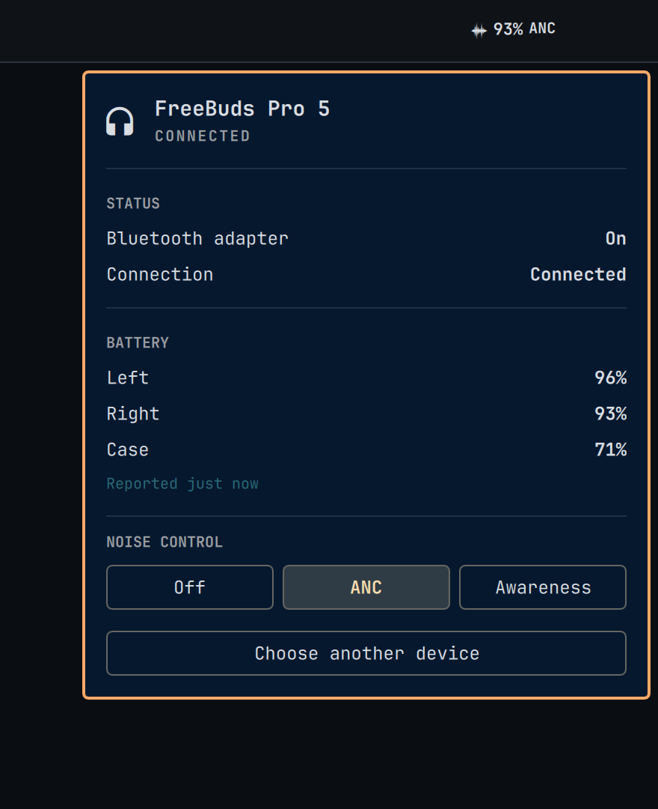

# FreeBuds Pro 5 for Omarchy

**Hardware validation pending:** this plugin targets only HUAWEI FreeBuds Pro 5,
public model T0023 and private DeviceInfo model ID `00016D`. Every row from
`HW-01` through `HW-16` is `Not run`.
No hardware test is claimed as passed. No other model is supported; unavailable
private access falls back to display-only generic Bluetooth status.

The plugin adds an always-visible Omarchy 4 bar widget. Quickshell supplies
paired, connected, adapter, and fallback `Earbuds` battery state. After a fresh
verified component read, the panel shows only left, right, and case values and
the bar uses the lower earbud percentage; the case is never part of that compact
value. The widget also shows a verified `OFF`, `ANC`, or `AWR` mode with a
matching dynamic glyph. A bundled, standard-library Python bridge implements
gated battery reads and only `Off`, `ANC`, or `Awareness` writes, with a fresh
readback required for success. Those private paths have not passed physical
hardware validation.



> The preview uses deterministic fixture values. It is not physical hardware
> evidence. It depicts a successful verified private refresh; when that refresh
> fails, the panel intentionally keeps only generic Bluetooth status visible.

This is an unofficial project. It is not affiliated with, endorsed by, or
supported by Huawei. It ships no Huawei or Omapods code, logos, or other
assets.

## Release Status

Release `0.1.1` is gated by the authoritative
[`docs/hardware-validation.md`](docs/hardware-validation.md) ledger, which is
currently `Pending` with all sixteen rows `Not run`. Therefore no release tag is
currently eligible to pass CI.

A release tag can pass only when the ledger says `Status: Passed`, every
HW-01..HW-16 row says `Pass`, and `v0.1.1` is an annotated tag on the exact
green `main` commit containing a complete PGP or SSH signature envelope. CI
queries GitHub's annotated-tag REST object with the workflow token and accepts
the tag only when GitHub cryptographically verifies the PGP or SSH signature
with `verification.verified` equal to `true` and
`verification.reason` equal to `valid`. API errors, malformed responses, forged
signature markers, lightweight tags, unsigned annotated tags, and hardware rows
that are `Fail` or `Not run` are rejected. CI is not configured with a private
signing key.
No current signing readiness is claimed.

## Requirements

- Omarchy `4.0.0-1`.
- Host-provided Quickshell `0.3.0.r20.g28771c7-1` at revision
  `28771c7c74b42e20afca0b1b63980cb46515537c`, with Qt `6.11.1`.
- Host `python3`, the Python standard library, and the Linux Bluetooth socket
  ABI.
- Owner-authorized FreeBuds Pro 5 paired, bonded, and connected through
  Omarchy Bluetooth.

The bar widget also supports Omarchy 4.5's optical icon sizing. Version `0.1.1`
fixes the icon, battery percentage, and noise-control label being shrunk together.
Host smoke tests cover both the original Omarchy 4.0 contract and Omarchy 4.5.
The fix was also tested locally on Omarchy `4.5.0-3`, Quickshell
`0.3.2.r7.g2b4501a-1`, and Qt `6.12.0` using fixtures, not physical hardware gates.

No OpenFreebuds, AUR package, systemd unit, build step, or separately installed
helper is required.

## Install

Omarchy plugins run unsandboxed in the long-lived shell process. Review the
source before enabling it.

After this repository is published at its canonical Git URL, install and
enable the current default-branch revision directly:

```bash
omarchy plugin add https://github.com/filipechagas/omarchy-huawei-freebuds.git --enable
```

Omarchy clones the remote default `HEAD`, and `omarchy plugin update` later
fast-forwards to `origin/HEAD`; it does not select a GitHub release or version
tag. Therefore `main` is the distribution channel and must always be
release-ready. An eligible annotated `vX.Y.Z` tag whose PGP or SSH signature
GitHub cryptographically verifies records a reviewed release, but does not pin
installation or updates.

## Use

1. Pair and connect the earbuds in Omarchy Bluetooth. This plugin never pairs,
   connects, disconnects, forgets, scans, changes adapter power, or changes an
   audio profile.
2. Open the FreeBuds Pro 5 panel. Opening it may start one bounded private
   refresh for one eligible connected device.
3. If several exact-name candidates exist, select one locally and press
   `Retry`. Selecting a row alone does not contact or save the device.
4. With a verified component read, use the left, right, and case rows; the bar
   shows the lower left/right value and omits the case. Otherwise the plugin
   falls back to Quickshell's generic `Earbuds` percentage.
5. Use `Off`, `ANC`, or `Awareness` only when those controls appear. A change is
   reported successful only after matching readback from the same bounded
   transaction.

Private data is fresh through 130 seconds. It is marked out of date from 131
seconds through 10 minutes and then cleared. Reconnecting, closing the panel,
or waiting does not contact the private channel. Press `Retry` for a new,
single attempt.

## Privacy And Security

- Runtime communication is local except for Bluetooth RFCOMM channel 1 to the
  selected earbuds. Medium Bluetooth security is mandatory; there is no
  insecure fallback, channel scan, automatic retry, background polling, or
  reconnect contact.
- The plugin makes no IP-network connection and has no telemetry, analytics,
  update check, runtime download, HTTP service, TCP/UDP socket, or D-Bus
  owner. Omarchy itself uses Git only when the user installs or updates the
  plugin.
- The attached Python child runs unprivileged, accepts a narrow JSON Lines
  protocol on stdin/stdout, and exits with the plugin. It is not a daemon and
  does not survive disable, reload, update, or removal.
- The only persistent device datum is the selected Bluetooth address in
  `${XDG_CONFIG_HOME:-$HOME/.config}/omarchy/io.github.filipechagas.freebuds.json`.
  The file must be regular, non-symlinked, and mode `0600`.
- Component batteries, ANC state, DeviceInfo values, and private frames are
  not persisted. Complete addresses and private identity values are omitted
  from UI and diagnostics.
- CRC is only an integrity check. Medium transport security, strict `00016D`
  identity, and a retained Pro 5 response shape must all pass before private
  state or a write is allowed.

## Troubleshooting

Generic Quickshell status remains available when private access fails.

| State | Action |
|---|---|
| No adapter or Bluetooth is off | Use Omarchy Bluetooth to enable Bluetooth. |
| No eligible device | Pair FreeBuds Pro 5 in Omarchy Bluetooth. |
| Device is disconnected | Connect it in Omarchy Bluetooth, then reopen the panel or press `Retry`. Reconnection alone performs no private access. |
| Several candidates | Select one without exposing its address, then press `Retry`. |
| Private bridge unavailable, stopped, or rejected its protocol | Press `Retry` once. The plugin does not restart it automatically. |
| Secure private channel unavailable, busy, refused, or timed out | Normal audio and generic status remain usable. Press `Retry`; no lower security or alternate channel is attempted. |
| Device is not verified or capabilities are not verified | Confirm the device is T0023. Other models are intentionally unsupported; choose another device if needed. |
| Component battery is not reported | Keep using the generic `Earbuds` fallback and press `Retry` if component data is needed. Missing data is never shown as `0%`. |
| Noise control is not reported | Battery state remains available. Press `Retry` if noise control is needed. |
| Private data is out of date | Press `Retry`. Aging itself performs no Bluetooth traffic. |
| Saved selection is invalid | Disable the plugin, remove the optional selection file shown below, re-enable, select the device, and press `Retry`. |

There is no automatic packet retry or ANC write replay. A failed write
confirmation leaves the control failed or unknown rather than claiming the
requested mode.

## Update

Because an update can hot-reload tracked files, a conservative update sequence
is:

```bash
omarchy plugin disable io.github.filipechagas.freebuds
omarchy plugin update io.github.filipechagas.freebuds
omarchy plugin enable io.github.filipechagas.freebuds
```

Do not develop inside Omarchy's installed checkout; update validation may roll
back tracked changes.

## Disable And Remove

Disable the widget and its attached child without deleting the checkout:

```bash
omarchy plugin disable io.github.filipechagas.freebuds
```

Remove the plugin checkout (removal also disables it):

```bash
omarchy plugin remove io.github.filipechagas.freebuds
```

The selected-address file remains so a reinstall can reuse the selection. To
delete that optional local datum after disabling or removing the plugin:

```bash
rm "${XDG_CONFIG_HOME:-$HOME/.config}/omarchy/io.github.filipechagas.freebuds.json"
```

## License

Copyright (c) 2026 Filipe Chagas. Licensed under the [MIT License](LICENSE).
