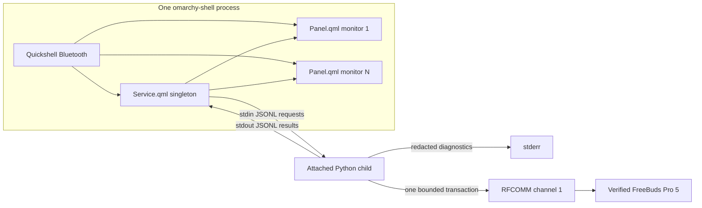

# FreeBuds Pro 5 Omarchy Plugin Architecture

Status: Accepted and authoritative
Decision date: 2026-08-18
Implementation target: `0.1.0`
Plugin ID: `io.github.filipechagas.freebuds`
License: `MIT`

## 1. Authority and scope

This document is the closed architecture decision record for the first release. It supersedes every conflicting recommendation in the research reports. The reports remain evidence sources; they are not implementation authority. [`hardware-validation.md`](hardware-validation.md) is the authoritative physical release ledger.

The release supports one hardware target: **HUAWEI FreeBuds Pro 5**, public model **T0023**, with private DeviceInfo model ID **00016D**. A name match is only a candidate-selection hint. It never establishes private-protocol capability.

The release provides:

- An Omarchy 4 native bar widget and panel that are always present when enabled.
- Generic paired, connected, adapter, and fallback aggregate-battery state from `Quickshell.Bluetooth`.
- Experimental left, right, and case battery observations from strictly validated Huawei RFCOMM responses.
- Experimental top-level noise-control state and explicit `Off`, `ANC`, and `Awareness` actions.
- A deterministic generic BlueZ fallback whenever private access is unavailable.

The release does not manage Bluetooth. Pairing, connecting, disconnecting, forgetting, adapter power, discovery, trust, and audio profiles remain the responsibility of Omarchy, BlueZ, and PipeWire/WirePlumber.

## 2. Evidence precedence

The evidence base is:

1. [`research/freebuds-pro-5-protocol.md`](research/freebuds-pro-5-protocol.md) for retained Pro 5 frames, framing, CRC, identity evidence, and hardware gates.
2. [`research/omarchy-plugin-platform.md`](research/omarchy-plugin-platform.md) for the inspected Omarchy 4 and Quickshell runtime contracts.
3. [`research/product-spec.md`](research/product-spec.md) for useful interaction, accessibility, freshness, and acceptance requirements that do not conflict with this record.

When those reports conflict with this document, this document wins. In particular:

| Research proposal | Final decision |
|---|---|
| OpenFreebuds runtime integration | No OpenFreebuds package, import, process, RPC, or compatibility layer |
| Omapods architecture or source reuse | Independent QML and Python implementation; no Omapods code or assets |
| `freebuds.pro5` plugin ID | `io.github.filipechagas.freebuds` |
| `GPL-3.0-or-later` or `GPL-3.0-only` | `MIT` |
| Separately packaged helper and systemd user service | One Python standard-library child attached to `Service.qml` |
| Helper-owned BlueZ inventory and connection management | Quickshell Bluetooth is authoritative; no Bluetooth mutations |
| Unix socket or loopback RPC | Versioned JSON Lines over child stdin/stdout; no IP networking |
| SDP discovery, channel search, or security fallback | Fixed RFCOMM channel 1 and `BT_SECURITY_MEDIUM`; fail closed |
| Persistent sessions, notifications, polling, reconnect, or automatic retry | One bounded socket per explicit transaction; close unconditionally |
| Private refresh after reconnect | No automatic private contact after reconnect; panel open or Retry is required |
| Manual Connect/Open Bluetooth actions in this panel | Status guidance only; the user uses Omarchy Bluetooth separately |
| Unverified private read diagnostics | No unverified private value reaches product state |
| Generic battery cross-validation gate | A finite connected `Quickshell.Bluetooth` `Battery1` value is authoritative only for the generic fallback aggregate |

## 3. Fixed platform contract

The supported host baseline is:

| Component | Fixed baseline |
|---|---|
| Omarchy | `4.0.0-1`, source `f0020448ca87329199de7cb12f2015ebc4a3e5e7` |
| Quickshell | `0.3.0.r20.g28771c7-1`, revision `28771c7c74b42e20afca0b1b63980cb46515537c` |
| Qt | `6.11.1` |
| Python | Host `python3`, standard library only |
| Linux transport | `AF_BLUETOOTH`/`BTPROTO_RFCOMM` with `SOL_BLUETOOTH`/`BT_SECURITY` |

The manifest is schema version 1 and contains exactly the supported identity and entry-point structure:

```json
{
  "schemaVersion": 1,
  "id": "io.github.filipechagas.freebuds",
  "name": "FreeBuds Pro 5",
  "version": "0.1.0",
  "author": "Filipe Chagas",
  "license": "MIT",
  "description": "Experimental battery and noise control for Huawei FreeBuds Pro 5.",
  "kinds": [
    "service",
    "bar-widget"
  ],
  "entryPoints": {
    "service": "Service.qml",
    "barWidget": "Panel.qml"
  },
  "barWidget": {
    "displayName": "FreeBuds Pro 5",
    "description": "Experimental battery and noise control for verified Huawei FreeBuds Pro 5 earbuds.",
    "category": "Audio",
    "allowMultiple": false,
    "defaultSection": "right"
  }
}
```

There is no settings schema, dependency hook, install hook, `keepLoaded`, compatibility shim, package recipe, runtime-generated artifact, or privileged setup. Enabling the bar entry enables the service. `docs/preview.png` is documentation only and is never loaded by the plugin.

Omarchy injects host properties after object creation. `Service.qml` declares nullable `shell` and `manifest` properties. `Panel.qml` treats injected `bar`, `moduleName`, and `settings` as nullable and never marks them `required`. The panel obtains the singleton reactively with `bar?.shell?.serviceFor(moduleName)` and renders a service-unavailable fallback until it exists.

## 4. System shape



There is exactly one long-lived Python process while the plugin service is loaded. The child is normally blocked reading stdin and owns no RFCOMM socket while idle. There is never more than one RFCOMM socket or one outstanding Huawei request.

The Python process is not a daemon. It has no systemd unit, package, Unix socket, TCP socket, HTTP endpoint, D-Bus owner, detached subprocess, or independent restart policy. `Service.qml` owns its lifetime through an attached Quickshell `Process`.

## 5. Repository and module boundaries

The implementation uses this fixed layout:

```text
.
|-- .gitignore
|-- .github/
|   `-- workflows/
|       `-- check.yml
|-- bridge/
|   `-- freebuds_bridge.py
|-- docs/
|   |-- architecture.md
|   |-- hardware-validation.md
|   |-- implementation-plan.md
|   |-- preview.png
|   `-- research/
|-- tests/
|   |-- python/
|   |   |-- test_framer.py
|   |   |-- test_jsonl.py
|   |   `-- test_transactions.py
|   `-- qml/
|       |-- fixtures/
|       |   `-- fake_bridge.py
|       |-- host-smoke/
|       |   `-- shell.qml
|       |-- run-host-smoke.sh
|       `-- tst_Model.qml
|-- LICENSE
|-- Model.js
|-- Panel.qml
|-- README.md
|-- Service.qml
`-- manifest.json
```

`.gitignore` excludes Python bytecode and `__pycache__` directories. `docs/preview.png` is an actual Omarchy layer-shell render using deterministic fixture values, not hardware evidence. The host-smoke harness constructs the real plugin entry points against the installed Omarchy shell, uses the fixed `tests/qml/fixtures/fake_bridge.py` child instead of hardware, verifies delayed property injection and shared-service behavior, and checks that service destruction leaves no bridge child.

| Module | Owns | Must not own |
|---|---|---|
| `manifest.json` | Stable plugin identity and Omarchy entry points | Dependencies, hooks, permissions, or compatibility claims the schema cannot enforce |
| `Panel.qml` | Native bar control, popup, keyboard interaction, accessible labels, candidate choice, and rendering | Process lifecycle, packet bytes, socket access, persistence writes, or Bluetooth mutation |
| `Service.qml` | Singleton child lifecycle, Quickshell Bluetooth projection, request serialization, generations, time-based invalidation, and public reactive state | Huawei frame parsing, shell command interpolation, detached execution, or generic Bluetooth actions |
| `Model.js` | Pure validation/reduction of primitive QML and JSONL values, view-state derivation, battery formatting, and safe user messages | IO, QObjects, timers, packet decoding, or side effects |
| `bridge/freebuds_bridge.py` | Strict framing, Pro 5 semantic gate, bounded RFCOMM transactions, JSONL boundary, and mechanical mode-`0600` persistence of the selected transport target | BlueZ discovery/state, pairing, connection management, QML, IP networking, telemetry, background contact, or arbitrary packet sending |

`freebuds_bridge.py` remains one auditable standard-library module. Its internals are divided into pure framer/decoder functions, a transport adapter, a transaction controller, the narrow config store, and the JSONL loop. Those internal seams are exercised with injected transports; they are not separate runtime processes.

QML owns the decision to select an address. The bridge only performs the atomic file operation because the QML host API does not provide a reliable owner-only permission primitive. The bridge never discovers, ranks, connects, or interprets generic Bluetooth state.

## 6. Two independent state planes

### 6.1 Generic BlueZ plane

`Quickshell.Bluetooth` is authoritative for:

- Whether a default adapter exists and is enabled.
- The current paired/bonded device inventory.
- Whether the selected device is connected.
- The selected device's display name.
- The selected device's live aggregate `Battery1` value.

The service projects Bluetooth QObjects into primitive snapshots before exposing them. It never stores a device QObject in a list-model row. Every action re-resolves the live backend object by address to avoid stale wrapper use after BlueZ churn.

A generic aggregate battery is valid only while the selected device is
connected, `batteryAvailable` is true, and `battery` is a finite value in
`0.0..1.0`. It is rendered as `Math.round(battery * 100)` and labeled `Earbuds`.
It is a fallback when no verified component observation is available and is
never relabeled as left, right, case, minimum, or average. Private tag `01`
never replaces or computes this generic aggregate.

The panel and bar never invoke pair, connect, disconnect, forget, discovery, trust, adapter-power, or profile methods. They provide text directing the user to Omarchy Bluetooth when such an action is required.

### 6.2 Private observation plane

Private state contains only:

- Whether the current address passed the identity and shape gates in the current service generation.
- Nullable integer left, right, and case percentages from a valid `01/08` response.
- Nullable top-level ANC mode `off`, `anc`, or `awareness` from a valid extended `2B/2A` response.
- A receipt time, nondecreasing age, and request generation.
- A stable error code with a short non-sensitive user message.

Private values are observations, not desired state. Missing, malformed, expired, or failed fields are `null`; zero is accepted only as an actual validated percentage. No private value is persisted.

Private observations are fresh for 130 seconds while Quickshell still reports the same address connected. From 131 seconds through 10 minutes the bar displays no private percentage and the panel marks retained values as out of date with their age. After 10 minutes the service clears the values. Any wall-clock rollback relative to the previous aging sample expires the private data immediately rather than extending freshness. The aging timer performs no device IO.

The service clears all private values and invalidates pending results when:

- Quickshell reports the selected device disconnected.
- The adapter disappears or turns off.
- The selected address changes.
- The child exits, is stopped, or is restarted.
- Device identity fails or conflicts.
- The JSONL protocol fails.
- Private data reaches its 10-minute expiry.

A refresh clears the previous private observations before opening a new transaction. An ANC action clears ANC state while pending. If its same-transaction identity gate fails, all private observations are cleared. A valid readback mismatch exposes the observed mode as an observation, but the requested action remains failed.

## 7. Candidate selection and persistence

The exact public candidate name is `HUAWEI FreeBuds Pro 5`. Candidate inventory contains only Quickshell devices whose immutable BlueZ `deviceName` equals that string and whose `paired` and `bonded` properties are true. Alias text is display-only and cannot make a device eligible.

Selection follows these rules:

1. A valid persisted address is preferred when it is still present in the paired/bonded Quickshell inventory.
2. With no persisted selection and no exact-name candidate, no private contact occurs.
3. With no persisted selection and one connected exact-name candidate, a panel-open refresh automatically verifies that address when the service is idle. It becomes selected only after `00016D` identity and at least one retained Pro 5 response shape both pass. A disconnected candidate causes no private contact.
4. With no persisted selection and multiple exact-name candidates, panel opening contacts none. The user marks one candidate locally, then presses `Retry`. Only that explicit Retry starts verification.
5. Picking a candidate does not itself contact the device or persist the address.
6. A failed gate leaves the address unselected. It is never promoted from name, timeout, default data, or a battery-only response without identity.
7. A persisted address remains selected across ordinary disconnects. Every private transaction still repeats the full identity gate before reads or writes.
8. `Choose another device` clears only the local selection record and private observations. It does not alter BlueZ.
9. A QML-authorized `selectOnSuccess:true` refresh may replace a stale address held by the bridge, but only after the requested candidate repeats the complete identity and retained-shape verification and the replacement is durably persisted. Stale persistence never authorizes the new address before reverification.

The selection file is:

```text
${XDG_CONFIG_HOME:-$HOME/.config}/omarchy/io.github.filipechagas.freebuds.json
```

Its complete schema is:

```json
{
  "schemaVersion": 1,
  "selectedAddress": "AA:BB:CC:DD:EE:FF"
}
```

The bridge accepts only an uppercase canonical six-octet address, creates the `omarchy` directory with mode `0700` when absent, rejects symlink targets, writes a same-directory temporary file with mode `0600`, flushes it, atomically replaces the target, and enforces mode `0600`. The file stores no device name, serial number, battery, firmware, ANC state, or protocol data.

Every config operation takes a nonblocking advisory lock on the already validated parent-directory descriptor and waits at most one second, measured with Linux `CLOCK_BOOTTIME`. Load contention reports `config_invalid`; save or clear contention reports `config_write_failed`. An ordinary persisted-address refresh or ANC action holds a shared selection lease from its final config read until the device transaction closes. Selection changes require the exclusive lock, so a cooperating second bridge cannot clear or replace the persisted authorization during device contact.

An unreadable, malformed, unknown-schema, non-regular, symlinked, or non-owner-only config is treated as no selection. The bridge reports `config_invalid`; it performs no private contact. A newly verified selection overwrites the invalid regular file atomically. A failed persistence operation means verification does not commit selection or private product state.

## 8. Child lifecycle and JSON Lines contract

`Service.qml` starts the child only after `manifest.__sourceDir` exists:

```qml
["/usr/bin/env", "python3", manifest.__sourceDir + "/bridge/freebuds_bridge.py", "--stdio"]
```

The `Process` is attached, has stdin enabled, and uses the manifest source directory as its working directory. No address, name, mode, or untrusted value is interpolated into argv or a shell command. `bash -c`, `Quickshell.execDetached`, and `startDetached()` are forbidden.

The bridge completes startup within two seconds. For a valid or missing config it emits one final `hello` line with JSONL protocol version `1`, bridge version `0.1.0`, and a nullable selected address. For an invalid config it first emits the narrow `config_invalid` startup error and then emits the final valid `hello` with `selectedAddress:null`. The service settles both lines before acting on a deferred panel or Retry intent and does not issue a transaction before the final hello.

The service sends only these version-1 requests:

```json
{"v":1,"type":"request","id":1,"generation":4,"method":"refresh","address":"AA:BB:CC:DD:EE:FF","selectOnSuccess":false}
{"v":1,"type":"request","id":2,"generation":4,"method":"set_anc","address":"AA:BB:CC:DD:EE:FF","mode":"anc"}
{"v":1,"type":"request","id":3,"generation":5,"method":"clear_selection"}
{"v":1,"type":"request","id":4,"generation":5,"method":"shutdown"}
```

`refresh` is used for panel-open refresh and Retry. `selectOnSuccess` is true only for an unpersisted candidate that the deterministic candidate rules permit. `set_anc` accepts only `off`, `anc`, or `awareness`. Local `clear_selection` and `shutdown` never open Bluetooth sockets.

Every response echoes `id` and `generation`, is exactly one `result` or `error`, and contains only validated primitive fields. Lines are UTF-8 JSON without NaN or Infinity and are bounded to 16 KiB. Accepted request IDs are strictly increasing for the lifetime of one child; a duplicate or lower ID is rejected and never dispatched. Unknown versions, message types, methods, fields, enums, overlong lines, malformed JSON, and wrong primitive types fail closed.

The service allows one pending request. It never queues another panel-open refresh or ANC action behind it. Controls are disabled while pending. The bridge also rejects an unexpected concurrent request as `busy`; that accepted busy request still consumes its strictly increasing ID and is never queued.

The service accepts a device-IO response only when its `id`, request generation, selected address, and current Quickshell-connected state still match. Late results are discarded without changing state. The one exception is local `clear_selection`: because it opens no device socket and only reconciles owner-only config with local state, its response may complete against its matching pending ID and original request generation after the current generic generation has advanced.

Stdout contains protocol lines only. Stderr contains bounded diagnostics with Bluetooth addresses, serial-like DeviceInfo values, raw config, and battery snapshots redacted. No log line contains a complete Bluetooth address.

On normal service destruction, the service sends `shutdown`, closes stdin, and lets the attached process exit. Quickshell destruction remains the hard lifetime boundary. On an unexpected exit or hello/protocol failure, the service clears private state and does not restart automatically. Explicit `Retry` starts one fresh child and, after hello, one eligible refresh. A second failure again waits for user action, so no process restart loop exists.

## 9. Private transport policy

Every device transaction follows one fixed transport policy:

1. QML has already confirmed the address is paired, bonded, and connected.
2. The bridge validates canonical address syntax and, for an ordinary existing selection, equality with the selected transport target. The only exception is the `selectOnSuccess:true` stale-selection replacement path from Section 7, which gains no authority until full reverification and persistence succeed.
3. It creates one `AF_BLUETOOTH`, `SOCK_STREAM`, `BTPROTO_RFCOMM` socket.
4. Before `connect()`, it sets `SOL_BLUETOOTH`/`BT_SECURITY` to `BT_SECURITY_MEDIUM`.
5. Failure to set or verify medium security is terminal for that transaction. There is no low, insecure, or legacy link-mode fallback.
6. It connects only to `(address, 1)`. There is no SDP request, UUID search, channel scan, or channel range.
7. The connect deadline is 3 seconds, each expected response deadline is 2 seconds, and the complete transaction wall-clock deadline is 10 seconds.
8. It sends one request frame and waits for its expected service/command response before issuing the next request. No protocol sequence field is assumed.
9. Immediately before each send, it checks for already queued socket input. Any queued byte or EOF faults the transaction before the next request or write is sent; queued data is never adopted as the next response.
10. The retained protocol has no request sequence field. The pre-send guard, one outstanding request, expected service/command matching, and fresh socket reduce ambiguity but cannot prove causality if a delayed or unsolicited same-command frame arrives after the guard and before or after the send.
11. An unexpected service/command, bad frame, EOF, timeout, or socket error faults the transaction immediately. There is no automatic retry.
12. A `finally` path closes the socket after success, failure, cancellation, or shutdown.

The child performs no device contact at startup, on a timer, after BlueZ reconnect, after child restart, on panel close, or in response to config changes. A device socket can open only from:

- A transition of a panel instance from closed to open, when the service is idle and candidate rules identify one eligible address.
- An explicit `Retry` press.
- An explicit ANC mode press while private ANC controls are currently capability-gated.

When multiple monitor panels open during one request, the first request wins and no follow-up request is queued. Closing a panel does not replay or replace the already-started bounded request. Its result enters the singleton only if the address and generation still match.

## 10. Huawei frame boundary

### 10.1 Framing

The only accepted frame generation has:

| Offset | Meaning |
|---:|---|
| `0` | Magic `0x5A` |
| `1..2` | Big-endian declared length `L` |
| `3` | Version `0x00` |
| `4` | Service ID |
| `5` | Command ID |
| `6..` | One-byte type, one-byte length, and bounded TLV value |
| Final two bytes | Big-endian CRC-16/XMODEM |

Total bytes equal `L + 5`. CRC input is every byte from magic through the final TLV, with polynomial `0x1021`, initial value `0x0000`, and a high-byte-first result. The implementation uses `binascii.crc_hqx(data, 0)` and validates CRC before service, command, or TLV semantics.

The stream parser:

- Bounds a declared frame to 4096 bytes before allocation or waiting.
- Handles every split point, combined frames, and garbage before magic.
- Requires `L >= 3`, version `0x00`, a complete frame, and exact CRC.
- Bounds every TLV and rejects truncated or duplicate known TLVs.
- Retains well-formed unknown TLVs only in in-memory redacted diagnostics and assigns no meaning.
- Requires the expected service/command for the current request.
- Treats one malformed or unexpected response as a transaction fault.

Immediately after the medium-security RFCOMM connection, the transport requires
and consumes one exact CRC-valid empty `01/06` startup frame:
`5A00030001063EBD`. It sends no application frame before this preamble. A
missing, malformed, non-empty, combined, or different startup frame faults the
transaction. Before every query or write, input already visible at the send
boundary is accepted only when it is exactly one empty `01/06` control frame.
The bridge consumes that frame and reapplies the boundary before sending; any
other or additional queued input faults the transaction.

The same exact empty `01/06` frame may recur once while the bridge waits for an
expected query, acknowledgement, or readback response. It may arrive alone or
coalesced with exactly one expected frame. The bridge consumes it under the
original response deadline and never resends the request. A second empty
control frame, any other extra frame, or a complete frame followed by a partial
frame faults the transaction.

### 10.2 Immutable command corpus

Production code sends only these complete retained frames:

| Operation | Complete frame |
|---|---|
| Read DeviceInfo | `5A00210001070100020003000400050006000700080009000A000B000C000F0018001900DFF3` |
| Read component battery | `5A0009000108010002000300FBB9` |
| Read ANC state | `5A0005002B2A0100427E` |
| Set Off | `5A0007002B0401020000D22D` |
| Set ANC | `5A0007002B04010201FFFFEC` |
| Set Awareness | `5A0007002B04010202FFAABF` |

The bridge verifies these constants plus the received startup and ANC
acknowledgement constants for exact length and CRC at process startup. It does
not provide a generic command encoder, arbitrary packet API, debug send box,
notification subscription, or model command registry.

### 10.3 Identity gate

Every `refresh` and `set_anc` transaction starts with the DeviceInfo query and requires one CRC-valid `01/07` response. The strict identity decoder requires:

- Exactly one tag `02` of length two.
- Exactly one bounded ASCII tag `0A` ending in `00016D`.
- Exactly one bounded ASCII tag `0F` whose model prefix matches tag `0A`.
- Exactly one tag `19` of length one.
- No missing, duplicate, malformed, oversized, or conflicting known identity field.

The public `T0023` model and Bluetooth name never substitute for `00016D`. Identity success advances only the current socket transaction; it is not cached as permission for a later transaction.

After identity, product state requires at least one CRC-valid retained Pro 5 response shape:

- Battery: service/command `01/08`, tag `02` length three with left/right/case in `0..100`, and tag `05` length two with each byte in `{0,1}`.
- ANC: service/command `2B/2A`, tag `01` length two with a top-level mode byte in `{0,1,2}`, plus exact tag `02 01 05`.

Shorter ANC responses retained for other models are rejected. A battery response without valid tag `05` is not Pro 5-shaped. Identity without either shape does not select an unpersisted candidate and exposes no private values.

Tag `01` aggregate battery is ignored because Quickshell supplies the generic
fallback aggregate. Tag `03` charging bytes, tag `04`, tag `06`, ANC submode,
and every unknown field are withheld from the product UI in `0.1.0`. The
retained corpus does not establish enough Pro 5 semantics for those values.

## 11. Transaction definitions

### 11.1 Refresh

A refresh performs this sequence on one socket:

1. Require the exact empty `01/06` startup frame within the connection deadline.
2. Query and strictly verify DeviceInfo `00016D`.
3. Query battery once and independently decode the Pro 5 battery shape.
4. Query ANC state once and independently decode the extended Pro 5 ANC shape.
5. Close the socket.
6. Return each valid feature as a timestamped observation and each failed feature as `null` with a feature error.

Identity failure invalidates the entire result. After identity succeeds, one valid feature can be returned when the other feature fails. At least one valid Pro 5-shaped feature is required to mark the address read-verified or to persist a new selection. ANC controls appear only when the ANC response itself is valid.

There is no second attempt for a timeout, malformed feature response, or missing field. Retry is a separate user action and a new socket.

### 11.2 ANC action

An explicit ANC action performs this sequence on one new socket:

1. Require the exact empty `01/06` startup frame within the connection deadline.
2. Query and strictly verify DeviceInfo `00016D`.
3. Query and strictly validate the extended Pro 5 ANC state.
4. If the current top-level mode already equals the requested mode, perform no write and return the matching read as success.
5. Otherwise send exactly one retained write frame for `off`, `anc`, or `awareness`.
6. Receive exactly one post-write response. Accept either a CRC-valid extended `2B/2A` state response or the exact CRC-valid `2B/04` zero-status acknowledgement `5A0006002B040201003171`.
7. Use a direct extended state response as the readback. After the acknowledgement route, query ANC state exactly once for the readback.
8. Require the readback's top-level mode to equal the request; acknowledgement or `sendall()` success alone never updates product state.
9. Close the socket.

Only a matching post-write state response is success. The target firmware may
return that state directly, while the retained acknowledgement route requires
one following query. Missing, malformed, rejected, timed-out, or mismatched
confirmation is failure. The bridge never repeats the write, sends an inverse
write, or reports optimistic state. A valid mismatching state is displayed as
the observed current mode while the action reports `anc_readback_mismatch`.

## 12. Service interface and generations

`Service.qml` exposes read-only primitive state plus these user-facing functions:

```qml
function panelOpened(): void
function retry(): void
function markCandidate(address: string): void
function setAnc(mode: string): void
function clearSelection(): void
```

`markCandidate` is local and performs no IO. `panelOpened`, `retry`, and `setAnc` are the only functions that can lead to private device contact. `clearSelection` only updates local config and state.

The service maintains a monotonically increasing generation. It increments the generation on selected-address change, helper start/exit, adapter loss/power-off, and selected-device disconnect. Every request and result carries that generation. A stale generation is ignored even when its request ID is otherwise valid, except that the matching local-only `clear_selection` result may reconcile across a generic generation change as defined in Section 8.

No external IPC method starts private contact. `Panel.qml` sets `manageIpc: false` and toggles its own per-monitor panel directly from its bar button. This avoids duplicate `IpcHandler` targets and prevents an undocumented fourth transaction trigger.

## 13. UI contract

The widget is always visible while enabled. It uses Omarchy's native `Panel`,
`BarIconButton`, typography, spacing, colors, focus surfaces, and host-supplied
monochrome glyphs. It ships no Huawei logo, product illustration, Omapods icon,
bitmap, or custom font. The generic fallback is display-only: it can render
Quickshell adapter, connection, candidate, and aggregate-battery observations,
but it cannot pair, connect, select persistently, open the private channel, or
invoke any other device IO.

The bar shows:

- A host glyph in every state.
- The lower of fresh verified left and right percentages when component battery data is available; case battery is excluded.
- The Quickshell aggregate percentage only as a fallback when no private component battery observation is shown.
- A fresh verified ANC mode changes the glyph and adds `OFF`, `ANC`, or `AWR`; pending, stale, missing, and fallback states claim no mode.
- No percentage for stale private component observations.
- An accessible status name that does not rely on color.

The panel shows, in order:

1. `FreeBuds Pro 5` with an `Experimental` label.
2. Generic adapter and selected-device connection state from Quickshell.
3. Either a generic `Earbuds` aggregate fallback or verified left, right, and case rows, never both presentations together.
4. Private component rows only for valid observations; unknown fields read `Not reported` and never `0%` by default.
5. A timestamp or out-of-date message for private observations.
6. `Off`, `ANC`, and `Awareness` controls only after a valid extended ANC response for the connected selected address.
7. One safe next action: candidate choice, `Retry`, or `Choose another device`, according to state.

There is no Connect, Disconnect, Pair, Forget, Scan, Bluetooth power, trust, codec, device-EQ, gesture, low-latency, wear-detection, multipoint, firmware, or OpenFreebuds control.

Buttons support keyboard focus, Enter/Space activation, visible focus, accessible names, and disabled explanations. Text and icons convey every state without relying on color. The panel remains usable at the host's supported scale and on narrow monitor layouts; long names and errors elide or wrap without exposing addresses.

## 14. Deterministic failure policy

Generic Quickshell state remains available in every row below unless the shell itself cannot provide it. No failure causes a Bluetooth mutation, security downgrade, channel search, socket retry, write replay, private-value fabrication, or detached process.

| Failure or state | Required state transition | User-visible fallback | Device contact after failure |
|---|---|---|---|
| Service has not been injected | Panel uses direct Quickshell generic projection; private state absent | `FreeBuds service is starting` | None |
| Service QML fails to load | Panel remains visible with direct generic projection | `Private controls unavailable` | None |
| Python executable or bridge file missing | Child phase becomes `failed`; clear private state | Generic state plus `Private helper unavailable` and `Retry` | Only a later explicit Retry attempts child startup; no device contact until hello |
| Hello exceeds two seconds | Stop child; clear private state | `Private helper did not start` and `Retry` | None |
| Child exits or is killed | Increment generation; clear private state; do not auto-restart | Generic state plus `Private helper stopped` and `Retry` | None |
| Child restarts after Retry | Increment generation; keep private state clear until fresh success | `Refreshing private status` | One eligible Retry transaction after valid hello |
| Malformed, oversized, wrong-version, duplicate, or unknown JSONL message | Stop child; increment generation; clear private state | `Private helper protocol error` and `Retry` | None |
| Late or mismatched request result | Discard result | Existing current state remains | None |
| Request already pending | Reject the second trigger and leave controls disabled | `Private request already in progress` | No queued or follow-up contact |
| No Bluetooth adapter | Clear private state; preserve selected address | `No Bluetooth adapter` | None |
| Adapter disabled | Clear private state; preserve selected address | `Bluetooth is off. Use Omarchy Bluetooth to turn it on.` | None |
| No exact-name paired/bonded candidate | Remain unselected | `Pair FreeBuds Pro 5 in Omarchy Bluetooth` | None |
| One unselected candidate is disconnected | Remain unselected until connected | `Connect the earbuds in Omarchy Bluetooth` | None |
| Multiple candidates exist | Keep all unselected until one is marked and Retry is pressed | Candidate list plus `Select a device, then Retry` | None before Retry |
| Persisted address is absent from current inventory | Preserve config but treat device as unavailable | `Selected earbuds are not available` plus `Choose another device` | None |
| Selected device disconnects | Increment generation; clear private state; preserve selection | Generic disconnected state | None; reconnect alone does not trigger private access |
| Config missing | Treat as no selection | Normal candidate flow | Only eligible panel-open or Retry flow |
| Config invalid, symlinked, or too permissive | Refuse it and treat as no selection | `Saved device selection is invalid` plus candidate flow | None until a valid candidate transaction |
| Config write fails after successful verification | Do not commit selection or private result | `Could not save device selection` and `Retry` | None |
| Address syntax is invalid or does not match persisted target | Reject before socket creation | `Invalid selected device` | None |
| Bluetooth socket constants or RFCOMM are unavailable | Mark transaction failed | Generic state plus `Secure private channel unavailable` | None |
| `BT_SECURITY_MEDIUM` set or verification fails | Close socket; no downgrade | `Secure private channel unavailable` | Only a new explicit trigger repeats the same medium policy |
| Channel-1 connect is refused, busy, or times out | Close socket | Generic state plus `Private channel unavailable` and `Retry` | None |
| Device disconnects during a transaction | Socket fails or closes; QML generation changes; discard result | Generic disconnected state | None |
| Complete transaction exceeds 10 seconds | Close socket and fault request | `Private request timed out` and `Retry` | None |
| Frame length is invalid or over 4096 bytes | Close socket; expose no frame data | `Invalid private response` and `Retry` | None |
| Frame is truncated, wrong-version, or CRC-invalid | Close socket; expose no parsed fields | `Invalid private response` and `Retry` | None |
| Expected service/command does not match | Close socket | `Unexpected private response` and `Retry` | None |
| Known TLV is missing, duplicate, malformed, or conflicting | Reject affected semantic response | Feature is `Not reported`; Retry available | None |
| Unknown well-formed TLV appears | Ignore its semantics | No extra UI field | Continue only with the expected known shape in the same transaction |
| DeviceInfo is absent or does not end in `00016D` | Close socket; clear all private state; do not persist | `This device is not a verified FreeBuds Pro 5` | None |
| DeviceInfo fields conflict | Close socket; clear all private state | `Device identity conflict` | None |
| Identity passes but no retained Pro 5 response shape passes | Do not select and expose no private feature | Generic state plus `Private capabilities not verified` | None |
| Battery response is absent or malformed | Clear component fields for this refresh | `Battery components not reported`; generic aggregate remains | None |
| Component percentage is outside `0..100` | Reject that battery response; never clamp | `Battery components not reported` | None |
| Generic `batteryAvailable` is false or value is non-finite/out of range | Hide generic fallback percentage | `Earbuds battery not reported` when private components are unavailable | None |
| ANC response is absent, short other-model shape, or unknown | Clear ANC and hide controls | `Noise control not reported` | None |
| ANC request equals current mode | Send no write; accept the fresh matching read | Current mode remains selected | Socket closes normally |
| ANC frame cannot be fully sent | Close socket; clear ANC; do not replay | `Noise control change was not confirmed` and `Retry` | None |
| Post-write response is neither an exact success acknowledgement nor a valid extended ANC state | Close socket; clear ANC; do not replay | `Noise control change was not confirmed` and `Retry` | None |
| ANC readback is absent, invalid, or times out after an acknowledgement | Close socket; clear ANC; do not replay or invert | `Noise control change was not confirmed` and `Retry` | None |
| ANC readback is valid but differs | Report action failure and show the valid observed mode | `Earbuds reported a different mode` and `Retry` | None |
| Private observation reaches 131 seconds | Mark stale; remove private bar metric and disable private controls | Timestamp plus `Battery data is out of date` and `Retry` | None |
| Private observation exceeds 10 minutes | Clear expired values | `Not reported` and `Retry` | None |
| Wall clock rolls back relative to the previous aging sample | Expire private observations immediately | `Not reported` and `Retry` | None |
| Panel closes during a transaction | Keep the one bounded request running in the singleton | No popup state; bar updates only from a still-current result | No additional contact |
| Plugin is disabled, reloaded, updated, or removed | Send shutdown, invalidate generation, destroy attached child | Widget disappears when disabled; no orphan process | None |
| System suspends while a request is active | Process/socket failure or generation invalidation clears private state | Generic state after resume; Retry required | No automatic resume contact |

## 15. Security and privacy invariants

- The plugin runs unprivileged as the shell user.
- The Python runtime dependency is the standard library only.
- Production code creates no `AF_INET`, `AF_INET6`, TCP, UDP, HTTP, WebSocket, or IP listener/client.
- Production code uses no D-Bus library and never owns or mutates BlueZ objects.
- Only `AF_BLUETOOTH` RFCOMM channel 1 is allowed for private device IO.
- Medium security is mandatory; lower security is not represented as a code path.
- Device names, addresses, modes, and errors are structured data, never shell text.
- Bluetooth addresses are omitted from UI, stdout diagnostics, stderr logs, crash messages, and release artifacts.
- The selected address is the only persistent device datum and is stored mode `0600`.
- Component batteries, ANC, DeviceInfo, firmware-like strings, and raw private frames are never persisted.
- There is no telemetry, analytics, update check, runtime download, package install, privilege escalation, or IP networking.
- CRC is an integrity check, not identity. Medium transport security, strict DeviceInfo, and retained model shape are all required.
- A valid name, address, CRC, or socket connection alone never enables a write.
- A write is restricted to three immutable captured frames and requires same-socket identity plus fresh extended ANC state.

## 16. Explicitly rejected branches

The following branches are closed for `0.1.0`. Implementing one requires a new architecture decision that supersedes this record.

| Rejected branch | Reason | Deterministic replacement |
|---|---|---|
| Import, package, launch, or call OpenFreebuds | Adds a broad mutable runtime and unneeded RPC/API coupling | Independent standard-library bridge with retained bytes only |
| Copy Omapods QML, assets, daemon, or librepods code | Wrong Apple protocol, unrelated lifecycle, provenance and fork burden | Independent native Omarchy QML and Huawei-specific Python |
| systemd user service | Creates a second lifecycle and orphan/update surface | One Quickshell-owned attached child |
| Separate helper/AUR package | Installer cannot enforce it and split updates add compatibility states | Auditable source bridge shipped in the plugin checkout |
| Unix-socket, TCP, HTTP, WebSocket, or loopback RPC | Unneeded server, authentication, and lifecycle surface | stdin/stdout JSONL on the owned child |
| IP networking of any kind | No product function requires it | Local Quickshell data plus direct Bluetooth RFCOMM |
| Helper-owned BlueZ D-Bus inventory | Duplicates and can conflict with Quickshell's live state | Quickshell Bluetooth is the only generic-state authority |
| Pair/connect/disconnect/forget/trust/adapter/discovery controls | Competes with the desktop's Bluetooth product | Status guidance directs the user to Omarchy Bluetooth |
| SDP lookup or RFCOMM channel scan | Expands contact beyond the retained target path | Fixed channel 1 or private-unavailable fallback |
| Low/insecure security fallback | Silent downgrade violates the fail-closed policy | `BT_SECURITY_MEDIUM` or private-unavailable fallback |
| Persistent RFCOMM socket | Unmeasured coexistence, power, and stale-state risk | New bounded socket for each explicit transaction |
| Background polling, notifications, heartbeat reads, or reconnect contact | Causes hidden device traffic and stale lifecycle complexity | Panel-open, Retry, and explicit ANC triggers only |
| Automatic read retry | Converts one trigger into undisclosed extra device traffic | One attempt; user presses Retry for a new attempt |
| Automatic write retry, inverse write, or optimistic update | Delivery can succeed before reply loss and make replay destructive | One exact write and one matching post-write state, directly or after an exact acknowledgement |
| Name-only, address-only, CRC-only, or battery-only identity | Each can match an unsupported or spoofed target | `00016D` DeviceInfo plus retained Pro 5 response shape |
| Unverified raw diagnostic values in product state | Risks presenting another model's data as Pro 5 data | Generic fallback with private fields absent |
| Support for other FreeBuds models | No closed fixture and identity corpus for them | Exact T0023/`00016D` target only |
| ANC strengths, voice submodes, gesture, EQ, wear, latency, multipoint, find, reset, or firmware writes | No retained Pro 5 request/readback corpus sufficient for safe control | Only top-level Off/ANC/Awareness |
| Private tag-01 aggregate or case-inclusive summary in the bar | Its combined semantics are not verified | Lower of fresh verified left/right, otherwise Quickshell aggregate fallback or no percentage |
| Huawei/Omapods logos, product art, or bundled custom icon | Unneeded asset and trademark/provenance surface | Host-native generic glyphs and text |
| Omarchy settings schema | There are no configurable policy choices in this release | Code constants plus one private selected-address record |
| External private-control IPC | Adds an undisclosed transaction trigger and multi-monitor target contention | Direct panel-to-singleton functions only |
| Automatic child restart loop | Can thrash the shell and obscures failure | One child start; explicit Retry after failure |

## 17. Release classification and hardware gate

Version `0.1.0` is **Experimental**. Passing physical validation authorizes an Experimental release tag; it does not promote the release to stable support or remove the Experimental label. Offline tests can establish parser and transaction correctness, but they cannot establish that retail T0023 firmware accepts Linux RFCOMM channel 1 with explicit medium security or that retained frames behave identically on the available unit.

[`hardware-validation.md`](hardware-validation.md) is the sole hardware status ledger. Its current status is `Pending`, and HW-01 through HW-16 are all `Not run`; no hardware test is claimed as passed. A release tag can pass only when that document says `Status: Passed` and every one of its sixteen rows says `Pass`.

An eligible release tag must be an annotated `vX.Y.Z` tag object at the exact green commit on `main` and must contain a complete PGP or SSH signature envelope. CI queries GitHub's annotated-tag REST object with its workflow token and accepts the tag only when GitHub cryptographically verifies the PGP or SSH signature with `verification.verified` equal to `true` and `verification.reason` equal to `valid`. The REST object's tag identity, direct commit target, signature, and signed payload must also be well formed and agree with the local tag object. API errors, malformed or mismatched responses, forged signature markers, lightweight tags, unsigned annotated tags, a mismatched manifest version, a non-main commit, a Pending or Failed hardware status, and any non-Pass hardware row fail CI. CI has no private signing key configured, and no current signing readiness is claimed.

If any hardware check fails or remains unexecuted, the exact row remains `Fail` or `Not run`, private controls remain fail-closed for the affected path, and no fallback channel, security level, model, dependency, or protocol branch is introduced.

## 18. Architectural acceptance criteria

The implementation conforms to this record only when all statements below are true:

- `omarchy plugin validate .` accepts the schema-v1 manifest with the fixed ID, version, license, and two entry points.
- Delayed injection and multi-monitor loading create one service child and no duplicate private transaction.
- The widget remains visible and generic Quickshell state remains useful without the child or private channel.
- Static dependency and socket checks find no OpenFreebuds, Omapods, non-standard Python import, IP networking, systemd unit, package recipe, or detached execution.
- All retained command frames match byte-for-byte and independently pass length and CRC checks.
- Framer tests cover every split point, combined reads, garbage, length bounds, version, CRC, TLV bounds, duplicates, and unexpected response pairs.
- Transaction tests prove same-socket identity gating, one outstanding request, fixed channel 1, mandatory medium security, unconditional close, no retry, and matching ANC readback.
- State tests prove disconnect/helper restart/generation changes clear private data and generic battery never becomes a component claim.
- Config tests prove canonical-address validation, symlink refusal, atomic replacement, mode `0600`, bounded advisory locking, and a shared selection lease through persisted-address device contact.
- UI tests prove private values and controls never appear before the corresponding strict gate and every failure has the documented fallback.
- Host smoke tests prove disable, reload, update, and removal leave no child process or socket.
- Repository checks reject symlinks and raw mode-`160000` gitlinks.
- Repository checks require the bounded `880x1080` PNG documentation preview and reject every other binary path.
- A release tag remains blocked until the hardware ledger is Passed in every row, the annotated tag contains a PGP or SSH signature envelope, and GitHub cryptographically verifies that signature with `verification.verified: true` and `verification.reason: valid`.
- The release remains Experimental even after the hardware gate passes.
