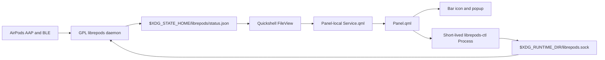
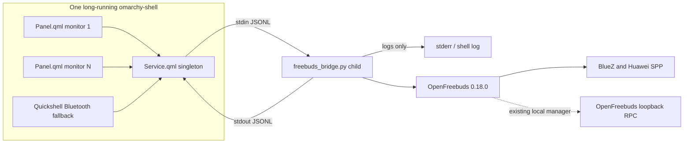

# Omarchy 4 Plugin Platform and FreeBuds Design

> [!WARNING]
> **Evidence only; superseded.** This report is retained for source evidence and
> is not implementation, product, platform, hardware-status, or release
> authority. Follow [`../architecture.md`](../architecture.md),
> [`../implementation-plan.md`](../implementation-plan.md), and
> [`../hardware-validation.md`](../hardware-validation.md). In particular, the
> OpenFreebuds dependency, AUR/package installation, external helper, systemd,
> GPL project-license, IPC, reconnect, polling, and release recommendations
> below were rejected and must not be followed.

Research snapshot: **2026-08-18**

This report identifies and reverse-engineers the Omarchy Plugins catalog entry `io.github.thisisgm.omapods`, checks it against the installed Omarchy 4 shell and Quickshell APIs, and turns those findings into one buildable design for an Omarchy Huawei FreeBuds plugin. It is a design report, not an implementation.

## Decisions At A Glance

| Area | Selected decision | Explicit fallback |
|---|---|---|
| Omapods source | Canonical source is [`thisisgm/omarchy-pods`](https://github.com/thisisgm/omarchy-pods), inspected at source commit `307c5a6d2109f088d8e6a558c933ebe4f6b1db01`, tag and manifest `v1.0.2` | Do not infer behavior from the catalog card alone |
| Host baseline | Omarchy package `4.0.0-1`, release source [`f0020448ca87329199de7cb12f2015ebc4a3e5e7`](https://github.com/basecamp/omarchy/commit/f0020448ca87329199de7cb12f2015ebc4a3e5e7) | Other Omarchy releases are unsupported until the same validation and smoke suite passes |
| Quickshell baseline | Host-provided Quickshell `0.3.0.r20.g28771c7-1`, revision `28771c7c74b42e20afca0b1b63980cb46515537c` | No legacy shell path; show an unsupported-host error or use the OpenFreebuds application |
| Plugin identity | `io.github.filipechagas.freebuds`, display name `FreeBuds`, initial version `0.1.0` | Never use the reserved `omarchy.*` namespace |
| Plugin shape | One manifest with kinds `service` and `bar-widget`; `Service.qml` owns one backend process and `Panel.qml` is instantiated per bar/monitor | If the service is unavailable, each widget renders only host-native generic Bluetooth state |
| FreeBuds backend | OpenFreebuds `v0.18.0`, immutable commit [`36310c1bbeedf067666bff2dd52f32cccb006935`](https://github.com/melianmiko/OpenFreebuds/commit/36310c1bbeedf067666bff2dd52f32cccb006935) | Missing or any other version gives generic BlueZ connection and aggregate battery only; ANC and component batteries are disabled |
| Backend integration | A small GPL Python adapter imports OpenFreebuds and speaks versioned JSON Lines over a Quickshell-owned child process | Do not call OpenFreebuds' private HTTP RPC directly from QML |
| Dependency installation | Package-manager-owned OpenFreebuds; no plugin install hook, vendored protocol fork, private venv, or systemd unit | The current AUR `0.17.3-1` is insufficient for FreeBuds Pro 5, so full-feature publication waits for AUR `0.18.0`; the plugin remains useful in generic fallback mode |
| Persistence | Visual preferences in the bar entry in `shell.json`; selected device in `$XDG_CONFIG_HOME/omarchy/io.github.filipechagas.freebuds.json` | Never write generated state into the Git checkout |
| License | License the proposed repository `GPL-3.0-only` and record dependencies in `THIRD_PARTY.md` | Do not copy Omapods code or branded assets in `v0.1.0`; if later copied, retain its MIT notice |
| Release channel | SemVer tags, with `main` always release-ready because Omarchy installs and updates remote `HEAD` | No unshipped ref-pinning or release-selection assumptions |

## Evidence And Scope

### Local Host Snapshot

The installed machine reports the following:

| Probe | Observed result |
|---|---|
| `omarchy version` | `4.0.0-1` |
| `omarchy version channel` | `stable` |
| `pacman -Q omarchy` | `omarchy 4.0.0-1` |
| `/usr/share/omarchy/version` | `4.0.0.alpha` |
| `pacman -Q quickshell-git` | `quickshell-git 0.3.0.r20.g28771c7-1` |
| `quickshell --version` | revision `28771c7c74b42e20afca0b1b63980cb46515537c` |
| Qt | `6.11.1` |
| Python | `3.14.7` |
| BlueZ | `5.87-2` |
| PipeWire | `1:1.6.8-1` |
| WirePlumber | `0.5.15-1` |

The version-marker discrepancy is real but not a different runtime. The official `v4.0.0` source tag also contains `4.0.0.alpha` in its [`version` file](https://github.com/basecamp/omarchy/blob/f0020448ca87329199de7cb12f2015ebc4a3e5e7/version), while [`omarchy-version`](https://github.com/basecamp/omarchy/blob/f0020448ca87329199de7cb12f2015ebc4a3e5e7/bin/omarchy-version#L18-L28) deliberately reads the installed Pacman package version. The supported baseline in this report is therefore package and command output `4.0.0-1`, not the source marker.

The following local checks passed:

```text
omarchy commands --check
omarchy-shell shell ping
omarchy plugin list --json
omarchy plugin validate /tmp/opencode/omarchy-pods-audit
gate_root=$(mktemp -d)
mkdir "$gate_root/qml-import"
ln -s /usr/share/omarchy/shell "$gate_root/qml-import/qs"
/usr/lib/qt6/bin/qmllint -W 0 -I "$gate_root/qml-import" Panel.qml Service.qml AirPodsIcon.qml
rm -rf "$gate_root"
deno run --allow-read tests/model.test.js
```

The Omapods tag does not have a Git signature: `git verify-tag v1.0.2` returned `error: no signature found`. That does not invalidate its source, but it means the tag supplies a convenient version name rather than authenticated publisher provenance.

### Limits

This research inspected source, package metadata, CLI behavior, QML type metadata, and tests. It did not pair physical FreeBuds hardware or build and run both Bluetooth daemons. The proposed hardware acceptance matrix is therefore a release requirement, not a completed result.

## Omapods Canonical Source And Provenance

The catalog entry's canonical repository is **[`https://github.com/thisisgm/omarchy-pods`](https://github.com/thisisgm/omarchy-pods)**.

This conclusion has three independent primary-source anchors:

1. The community marketplace registry maps the repository to plugin ID `io.github.thisisgm.omapods` and marks installation as manual because it manages a service and packages: [`registry.json`](https://github.com/HANCORE-linux/omarchy-plugin-marketplace/blob/17d1b90bc0ab77b79812d0a6e3cd3fc2f50d1ea5/registry.json#L8757-L8794).
2. The repository's root manifest declares the same ID, version `1.0.2`, and MIT root license: [`manifest.json`](https://github.com/thisisgm/omarchy-pods/blob/307c5a6d2109f088d8e6a558c933ebe4f6b1db01/manifest.json#L1-L41).
3. The repository README links its exact catalog entry and tells Omarchy to add this exact Git URL: [`README.md`](https://github.com/thisisgm/omarchy-pods/blob/307c5a6d2109f088d8e6a558c933ebe4f6b1db01/README.md#L1-L14), [`README.md`](https://github.com/thisisgm/omarchy-pods/blob/307c5a6d2109f088d8e6a558c933ebe4f6b1db01/README.md#L72-L80).

At the research snapshot, repository `main`, tag `v1.0.2`, manifest `1.0.2`, and commit `307c5a6d...` agree. The marketplace lists it as **Manual setup** and **unverified**, not as a no-setup verified plugin. Its automated baseline found no individual finding but classified `service-management` and `package-manager` capabilities for human review. The distinction matters: the marketplace is a community directory, while the Omarchy CLI installs a mutable Git default branch and performs no signature or marketplace-verification check.

## Omapods Repository Inventory

| Path | Responsibility | Runtime/build status |
|---|---|---|
| `manifest.json` | Omarchy schema-v1 identity and bar-widget metadata | Loaded by Omarchy |
| `Panel.qml` | Bar icon, popup, keyboard navigation, feature rows, IPC | Loaded once per live bar widget instance |
| `Service.qml` | Watches daemon state and runs one-shot control commands | Embedded inside each `Panel.qml`; it is not a manifest `service` |
| `Model.js` | Pure parsing, normalization, labels, ranges, command verbs | QML import and Deno-testable pure logic |
| `AirPodsIcon.qml` | Product-specific icon | Root MIT work, but product-specific and unsuitable for FreeBuds |
| `tests/model.test.js` | Parser and formatting fixtures | Runs with Deno |
| `daemon/` | Modified GPL-3.0 librepods C++/Qt daemon and CLI | Built manually, installed outside the plugin checkout |
| `daemon/librepods.service` | Long-lived systemd user service | Manually installed and enabled |
| `daemon/tests/` | C++ QtTest and QML tests | Built by CMake/CTest when `BUILD_TESTING` is on |
| `docs/` and `preview.png` | Screenshots and catalog presentation | Documentation only |

The root has no GitHub Actions workflow. The available tests are meaningful, but release automation is absent.

## Omapods Manifest And Host Loading

Omapods declares only `bar-widget`, not `service`:

```json
{
  "schemaVersion": 1,
  "id": "io.github.thisisgm.omapods",
  "name": "AirPods",
  "version": "1.0.2",
  "license": "MIT",
  "kinds": ["bar-widget"],
  "entryPoints": { "barWidget": "Panel.qml" },
  "barWidget": {
    "allowMultiple": false,
    "defaultSection": "right",
    "defaults": {
      "hideWhenDisconnected": true,
      "ctlPath": ""
    }
  }
}
```

Source: [complete manifest](https://github.com/thisisgm/omarchy-pods/blob/307c5a6d2109f088d8e6a558c933ebe4f6b1db01/manifest.json#L1-L41).

Omarchy registers `Panel.qml` as the component for the ID. The bar then creates one component per active bar surface/monitor and injects `bar`, `moduleName`, and the inline `settings` object. Omapods' `Panel.qml` creates its own `Service` child at [lines 103-118](https://github.com/thisisgm/omarchy-pods/blob/307c5a6d2109f088d8e6a558c933ebe4f6b1db01/Panel.qml#L103-L118). That means its service state is duplicated per monitor, but this is tolerable for Omapods because each copy only watches one file and starts short-lived commands on user action.

It would not be tolerable for FreeBuds if each widget started its own Bluetooth-owning process. Omarchy 4 has a first-class `service` kind precisely for one shared instance.

## Omapods Dependency And Installation Lifecycle

Omapods is not operational after `omarchy plugin add` alone. Its documented sequence is:

```bash
omarchy plugin add https://github.com/thisisgm/omarchy-pods --enable
omarchy bar move io.github.thisisgm.omapods

cd ~/.config/omarchy/plugins/io.github.thisisgm.omapods/daemon
cmake -B build -G Ninja && cmake --build build
cmake --install build --prefix ~/.local
systemctl --user enable --now librepods.service
```

Source: [requirements and install](https://github.com/thisisgm/omarchy-pods/blob/307c5a6d2109f088d8e6a558c933ebe4f6b1db01/README.md#L50-L96).

Build requirements are `cmake`, `ninja`, `qt6-connectivity`, `qt6-tools`, `qt6-declarative`, `pkgconf`, `libpulse`, OpenSSL, and the normal C++ toolchain. CMake builds a Qt Bluetooth/DBus/PulseAudio executable plus `librepods-ctl`, installs both to `~/.local/bin`, and installs a systemd user unit under `~/.local/share/systemd/user`: [`daemon/CMakeLists.txt`](https://github.com/thisisgm/omarchy-pods/blob/307c5a6d2109f088d8e6a558c933ebe4f6b1db01/daemon/CMakeLists.txt#L1-L109).

The service runs `%h/.local/bin/librepods --headless`, starts with the graphical session, restarts on failure after five seconds, and is deliberately not owned by the Omarchy shell: [`librepods.service`](https://github.com/thisisgm/omarchy-pods/blob/307c5a6d2109f088d8e6a558c933ebe4f6b1db01/daemon/librepods.service#L1-L16).

This produces an important lifecycle mismatch:

| Operation | What Omarchy changes | What happens to librepods |
|---|---|---|
| Add | Clones and optionally enables the plugin | Nothing; the user must build, install, and enable it |
| Disable | Removes the bar entry and unloads QML | Daemon continues running |
| Update | Fast-forwards the plugin checkout | Installed daemon binary is not rebuilt or restarted |
| Remove | Deletes the Git checkout | Installed binaries and user unit remain |

Removal must therefore happen in the documented order: stop/disable the unit, use CMake's `install_manifest.txt` while it still exists inside the checkout, then remove the plugin: [removal instructions](https://github.com/thisisgm/omarchy-pods/blob/307c5a6d2109f088d8e6a558c933ebe4f6b1db01/README.md#L98-L108). This is workable manual setup, but it is fragile and should not be copied into the FreeBuds design.

## Omapods Runtime Data Flow



The good part of this boundary is deliberate and deep:

- The daemon owns Bluetooth protocol complexity.
- It atomically writes one JSON state file only when state changes.
- `FileView` watches that file, so idle QML performs no polling and starts no process.
- Controls invoke an argv array, not shell interpolation.
- A local socket under the mode-0700 runtime directory carries commands.
- The QML parser rejects a future unsupported state schema instead of guessing.

Sources: [runtime explanation](https://github.com/thisisgm/omarchy-pods/blob/307c5a6d2109f088d8e6a558c933ebe4f6b1db01/README.md#L60-L70), [file watcher and command process](https://github.com/thisisgm/omarchy-pods/blob/307c5a6d2109f088d8e6a558c933ebe4f6b1db01/Service.qml#L30-L41), [state application and failure paths](https://github.com/thisisgm/omarchy-pods/blob/307c5a6d2109f088d8e6a558c933ebe4f6b1db01/Service.qml#L60-L104), [FileView and Process](https://github.com/thisisgm/omarchy-pods/blob/307c5a6d2109f088d8e6a558c933ebe4f6b1db01/Service.qml#L182-L230), [fork modifications](https://github.com/thisisgm/omarchy-pods/blob/307c5a6d2109f088d8e6a558c933ebe4f6b1db01/daemon/UPSTREAM.md#L20-L47).

The main weakness is freshness after an unclean daemon death. A clean daemon removes the file, but the state schema has no timestamp or heartbeat. A stale file can temporarily look reachable after a kill that bypasses cleanup. FreeBuds should carry sequence and freshness data and should let the shell directly observe its child process.

## Omapods Settings And State

Omapods declares two bar metadata settings:

| Key | Default | Consumer |
|---|---:|---|
| `hideWhenDisconnected` | `true` | `Panel.qml` controls widget visibility |
| `ctlPath` | empty | `Service.qml` falls back to `librepods-ctl` on `PATH` |

The plugin itself correctly supplies code fallbacks with `setting(name, fallback)`, so it behaves even when no settings metadata is applied. However, the installed Omarchy 4.0.0 shell only stores `defaults`, `schema`, and `settingsForm` in `BarWidgetRegistry` metadata. No installed QML consumer reads those metadata fields. On this host there is therefore no generated settings form, and manifest defaults are not merged into the bar entry. Manual `shell.json` values work because the bar injects the entry object directly.

FreeBuds must not rely on an unobserved settings form for essential device selection.

## Omapods UI And Failure States

Omapods has a strong product boundary. It shows component battery, listening modes, adaptive level, conversation awareness, one-bud ANC, ear detection, and case lid state. It intentionally delegates volume/output to Omarchy Audio and connection/pairing to Omarchy Bluetooth: [included and excluded scope](https://github.com/thisisgm/omarchy-pods/blob/307c5a6d2109f088d8e6a558c933ebe4f6b1db01/README.md#L16-L40).

| Runtime condition | Omapods behavior |
|---|---|
| Connected and fresh | Device/model hero, battery section, feature-gated controls |
| Battery advertisements but no audio link | Battery remains visible even when `connected` is false |
| Daemon file absent | `librepods is not running` and guidance text |
| Daemon reachable, device disconnected | `Not connected` and guidance text |
| Status JSON malformed or empty | Full default state plus a concise parse error |
| Status schema newer than 1 | Refuses to render fields and says both schema versions |
| Control command pending | Optimistic value held for four seconds |
| Repeated slider input | One last-write-wins queued command |
| Control command fails | Reverts by reloading state and displays elided stderr for 2.2 seconds |
| Unsupported feature/model | Omits the corresponding row rather than sending ignored commands |

The pure parser always returns a complete shape and explicitly handles absent objects, unavailable pods, invalid JSON, absent schema, and future schema: [`Model.js`](https://github.com/thisisgm/omarchy-pods/blob/307c5a6d2109f088d8e6a558c933ebe4f6b1db01/Model.js#L35-L139). The popup derives its cursor rows from currently visible controls, so keyboard focus does not land on hidden features: [`Panel.qml`](https://github.com/thisisgm/omarchy-pods/blob/307c5a6d2109f088d8e6a558c933ebe4f6b1db01/Panel.qml#L49-L102).

One multi-monitor caveat should not be copied: every Omapods panel instance declares an `IpcHandler` with global target `omapods`: [`Panel.qml`](https://github.com/thisisgm/omarchy-pods/blob/307c5a6d2109f088d8e6a558c933ebe4f6b1db01/Panel.qml#L120-L128). Quickshell IPC targets are global within the one shell process, while bar widgets may exist once per monitor. FreeBuds puts its one IPC target on the service singleton and leaves every `Panel.qml` at `manageIpc: false`.

FreeBuds should preserve those ideas but use request IDs rather than one global optimistic slot, and should not optimistically claim an ANC change before an authoritative backend snapshot.

## Omapods Test And Build Workflow

The root model test runs successfully with:

```bash
deno run --allow-read tests/model.test.js
```

It covers a captured live status line, omitted objects, stale pod fields, invalid/empty JSON, absent/future schema, command bounds, battery range formatting, and error elision: [`tests/model.test.js`](https://github.com/thisisgm/omarchy-pods/blob/307c5a6d2109f088d8e6a558c933ebe4f6b1db01/tests/model.test.js#L1-L88).

The daemon's CMake project enables CTest and has focused QtTest/QML tests for battery, device info, command parsing, IPC path, CLI behavior, stress, notifier, low battery, and visual primitives: [`daemon/tests/CMakeLists.txt`](https://github.com/thisisgm/omarchy-pods/blob/307c5a6d2109f088d8e6a558c933ebe4f6b1db01/daemon/tests/CMakeLists.txt).

A complete manual gate is:

```bash
gate_root=$(mktemp -d)
mkdir "$gate_root/qml-import"
ln -s /usr/share/omarchy/shell "$gate_root/qml-import/qs"
omarchy plugin validate .
/usr/lib/qt6/bin/qmllint -W 0 -I "$gate_root/qml-import" Panel.qml Service.qml AirPodsIcon.qml
deno run --allow-read tests/model.test.js
cmake -S daemon -B daemon/build -G Ninja -DBUILD_TESTING=ON
cmake --build daemon/build
ctest --test-dir daemon/build --output-on-failure
rm -rf "$gate_root"
```

The first three checks passed during this research. The daemon build and hardware path were not executed.

## Omarchy 4.0 Plugin Contract

### The Nine Plugin Commands

| Command | Effective behavior |
|---|---|
| `omarchy plugin add URL [--enable] [--yes]` | Warns that code is unsandboxed, clones remote `HEAD` to a staging directory, validates, rejects ID collisions, moves to the user plugin directory, rescans, and optionally enables |
| `omarchy plugin clone ID [--edit]` | Copies a built-in, rewrites its ID to `<user>.<id>`, records `omarchy.clonedFrom`, enables it, and replaces the built-in |
| `omarchy plugin disable ID` | Removes the effective shell reference and unloads it |
| `omarchy plugin enable ID [placement]` | Adds a bar widget to a selected/default bar section or adds non-widget kinds to `plugins[]` |
| `omarchy plugin list [--json]` | Asks the live shell for installed/enabled state |
| `omarchy plugin remove ID [--yes]` | Disables, deletes Git checkouts, unlinks dev symlinks, or backs up unmanaged folders, then rescans |
| `omarchy plugin update [ID] [--yes]` | Fetches `origin HEAD`, shows a diff, fast-forwards only, validates, and rolls back invalid updates |
| `omarchy plugin validate DIR` | Enforces schema/load-safety checks before installation |
| `omarchy plugin catalog` | Hidden local manifest walker used by other commands; it is not the website catalog |

Primary sources: [`add`](https://github.com/basecamp/omarchy/blob/f0020448ca87329199de7cb12f2015ebc4a3e5e7/bin/omarchy-plugin-add), [`clone`](https://github.com/basecamp/omarchy/blob/f0020448ca87329199de7cb12f2015ebc4a3e5e7/bin/omarchy-plugin-clone), [`enable`](https://github.com/basecamp/omarchy/blob/f0020448ca87329199de7cb12f2015ebc4a3e5e7/bin/omarchy-plugin-enable), [`remove`](https://github.com/basecamp/omarchy/blob/f0020448ca87329199de7cb12f2015ebc4a3e5e7/bin/omarchy-plugin-remove), [`update`](https://github.com/basecamp/omarchy/blob/f0020448ca87329199de7cb12f2015ebc4a3e5e7/bin/omarchy-plugin-update), [`catalog`](https://github.com/basecamp/omarchy/blob/f0020448ca87329199de7cb12f2015ebc4a3e5e7/bin/omarchy-plugin-catalog).

There is no dependency field or install/update/remove hook. A repository can contain scripts, but Omarchy will not execute them.

Commands that rescan, enable, disable, list, or remove require the live shell IPC endpoint. The [`omarchy-shell` wrapper](https://github.com/basecamp/omarchy/blob/f0020448ca87329199de7cb12f2015ebc4a3e5e7/bin/omarchy-shell#L19-L25) deliberately does not start the shell.

### Installation Location And Discovery

Third-party plugins live at:

```text
~/.config/omarchy/plugins/<manifest-id>/manifest.json
```

The root manifest is mandatory. First-party manifests may be grouped more deeply under `$OMARCHY_PATH/shell/plugins`; third-party manifests are accepted only at the top level of each user plugin directory. Runtime scanning and first-party precedence are implemented in [`PluginRegistry.qml`](https://github.com/basecamp/omarchy/blob/f0020448ca87329199de7cb12f2015ebc4a3e5e7/shell/services/PluginRegistry.qml#L544-L693).

Plugin edits hot-reload. The registry runs `inotifywait`, ignores hidden staging and `.git` events, unloads plugin panels/services/widgets, clears the component cache, rescans, and recreates enabled components: [`PluginRegistry.qml`](https://github.com/basecamp/omarchy/blob/f0020448ca87329199de7cb12f2015ebc4a3e5e7/shell/services/PluginRegistry.qml#L618-L715), [`shell.qml`](https://github.com/basecamp/omarchy/blob/f0020448ca87329199de7cb12f2015ebc4a3e5e7/shell/shell.qml#L734-L812). `omarchy refresh shell` is a reset/restart operation, not the normal plugin development loop.

### Schema Version 1

The CLI validator requires:

- `schemaVersion` equal to the JSON number `1`, not string `"1"`.
- Fields `id`, `name`, `version`, `kinds`, and `entryPoints` to exist.
- A nonempty `kinds` array and an object `entryPoints`.
- An ID matching `[A-Za-z0-9][A-Za-z0-9._-]*`, containing no `..`, and not starting with `omarchy.`.
- Every entry point to be a nonempty existing relative file with no newline, absolute prefix, or `..` substring.
- Known kinds to have their fixed key: `bar`, `barWidget`, `menu`, `overlay`, `panel`, or `service`.
- `barWidget.defaultSection`, when present, to be `left`, `center`, or `right`.
- No symlink anywhere under the plugin except Git internals.

Source: [complete validator](https://github.com/basecamp/omarchy/blob/f0020448ca87329199de7cb12f2015ebc4a3e5e7/bin/omarchy-plugin-validate#L31-L118). Runtime QML mirrors the security-sensitive checks but does not check file existence; the CLI is therefore the stronger publication gate: [`PluginRegistry.qml`](https://github.com/basecamp/omarchy/blob/f0020448ca87329199de7cb12f2015ebc4a3e5e7/shell/services/PluginRegistry.qml#L34-L108).

Unknown future kinds are deliberately accepted but have no loader; this is covered by Omarchy's [validator contract test](https://github.com/basecamp/omarchy/blob/f0020448ca87329199de7cb12f2015ebc4a3e5e7/test/shell.d/plugin-validate-test.sh#L94-L98). `allowMultiple` is advisory, `keepLoaded` affects only panel/overlay/menu loaders when it is exactly boolean `true`, and `activation`, aliases, defaults, schema, and settings forms provide no runtime enforcement at this tag. There are no manifest fields for host/backend version ranges, dependencies, hooks, permissions, state migrations, signatures, or checksums.

The validator checks structure, not behavior or provenance. It does not lint QML, execute tests, inspect dependencies, authenticate the Git owner, verify a tag/commit, or sandbox plugin code.

### Enablement And Multi-Kind Plugins

A third-party plugin is enabled when its ID appears in one of these places in `shell.json`:

- `bar.id` for a replacement bar.
- `bar.layout.left|center|right` for a bar widget.
- Top-level `plugins[]` for panels, overlays, menus, and standalone services.

For a plugin with `kinds: ["service", "bar-widget"]`, enabling the bar widget inserts one bar layout entry. That reference enables the whole manifest, so the shell loads one service singleton and registers the bar widget component. Disabling/removing the widget unloads both.

The shell's service host is generic for first- and third-party manifests. It creates one object per enabled service ID, injects `omarchyPath`, `shell`, `manifest`, registries when declared, and destroys it when disabled or removed: [`shell.qml`](https://github.com/basecamp/omarchy/blob/f0020448ca87329199de7cb12f2015ebc4a3e5e7/shell/shell.qml#L263-L359). A widget can retrieve it through `bar.shell.serviceFor(pluginId)`. The built-in Media plugin proves the same `service` plus `bar-widget` topology: [`media/manifest.json`](https://github.com/basecamp/omarchy/blob/f0020448ca87329199de7cb12f2015ebc4a3e5e7/shell/plugins/services/media/manifest.json), [`media/BarWidget.qml`](https://github.com/basecamp/omarchy/blob/f0020448ca87329199de7cb12f2015ebc4a3e5e7/shell/plugins/services/media/BarWidget.qml#L6-L16).

This is the correct process-ownership boundary for FreeBuds.

All entry points are ordinary `Item`s, not nested `ShellRoot`s. The host injects properties **after** object creation, so third-party entry points must not declare injected properties `required`; initialize them to safe null/empty values instead. Summonable surfaces expose `open(payloadJson)` and `close()`. If one manifest declares several of `panel`, `overlay`, and `menu`, the host selects only the first available kind in that priority order. Source: [shell development contract](https://github.com/basecamp/omarchy/blob/f0020448ca87329199de7cb12f2015ebc4a3e5e7/agents/skills/shell-dev.md#L12-L27) and [post-creation service/panel injection](https://github.com/basecamp/omarchy/blob/f0020448ca87329199de7cb12f2015ebc4a3e5e7/shell/shell.qml#L283-L320).

### Bar Widget Interface

The bar injects exactly three useful widget properties:

```qml
property QtObject bar
property string moduleName
property var settings
```

Source: [`Ui/BarWidget.qml`](https://github.com/basecamp/omarchy/blob/f0020448ca87329199de7cb12f2015ebc4a3e5e7/shell/Ui/BarWidget.qml#L4-L44) and the bar's [property injection](https://github.com/basecamp/omarchy/blob/f0020448ca87329199de7cb12f2015ebc4a3e5e7/shell/plugins/bar/Bar.qml#L1744-L1753).

For a clickable popup, `qs.Ui.Panel` and `KeyboardPanel` supply the established open/close, focus, outside-click, monitor, and panel-switch behavior. FreeBuds should use these host components rather than create an independent window or visual system. Audio and Bluetooth are the closest built-in visual references: [`audio/Panel.qml`](https://github.com/basecamp/omarchy/blob/f0020448ca87329199de7cb12f2015ebc4a3e5e7/shell/plugins/panels/audio/Panel.qml), [`bluetooth/Panel.qml`](https://github.com/basecamp/omarchy/blob/f0020448ca87329199de7cb12f2015ebc4a3e5e7/shell/plugins/panels/bluetooth/Panel.qml).

The service and independently summoned surfaces do not receive automatic `settings` injection. Only the bar widget receives its inline entry settings. This proposal therefore keeps presentation reads in `Panel.qml` and essential service state in the bridge-owned config file.

### Settings Metadata Is Not Persistence

The shell records manifest `defaults`, `settingsForm`, and `schema` in widget metadata: [`shell.qml`](https://github.com/basecamp/omarchy/blob/f0020448ca87329199de7cb12f2015ebc4a3e5e7/shell/shell.qml#L667-L717). In the released source and installed tree, no component consumes `metadataFor()`, `defaults`, or `schema`. The live widget receives only the explicit layout entry object.

Consequences for the proposed plugin:

- Use code fallbacks for all visual preferences.
- Treat inline bar settings as presentation, not essential state.
- Do not publish a schema and imply that Omarchy 4.0 renders it.
- Keep the selected device in a namespaced config file outside the checkout.
- Revisit generated settings only when a later host release actually ships and tests the consumer.

### Git Update And Trust Model

`omarchy plugin add` performs plain `git clone URL`, so it installs the remote's current default `HEAD`, not the latest release or a pinned tag. `omarchy plugin update` fetches `origin HEAD` and performs `merge --ff-only`; it does not compare manifest versions. An invalid manifest update is reset to `ORIG_HEAD`, but a QML runtime failure that passed validation has no automatic rollback: [`add`](https://github.com/basecamp/omarchy/blob/f0020448ca87329199de7cb12f2015ebc4a3e5e7/bin/omarchy-plugin-add#L89-L140), [`update`](https://github.com/basecamp/omarchy/blob/f0020448ca87329199de7cb12f2015ebc4a3e5e7/bin/omarchy-plugin-update#L39-L79).

There is also a narrow update race: Git writes the new checkout before validation, so the recursive plugin watcher can begin hot reload while validation is still running. For a high-assurance update, disable the plugin or stop the shell first. If validation fails, `git reset --hard ORIG_HEAD` may discard tracked edits that survived the fast-forward; never develop in the installed checkout. Manual copying bypasses the add command's file-existence and symlink checks entirely.

The installer correctly warns that plugins are arbitrary unsandboxed code in a long-lived shell process: [`omarchy-plugin-add`](https://github.com/basecamp/omarchy/blob/f0020448ca87329199de7cb12f2015ebc4a3e5e7/bin/omarchy-plugin-add#L96-L107). Marketplace listing or automated verification is not consulted by this command.

This determines the release policy: `main` must always be releasable, tags should be signed for human verification, and no repository migration may assume Omarchy installs a release asset.

## Quickshell API Conclusions

The selected design depends on APIs present in the installed Quickshell and documented in the `v0.3.0` API:

| API | Use in FreeBuds | Constraint |
|---|---|---|
| [`Process`](https://quickshell.org/docs/v0.3.0/types/Quickshell.Io/Process/) | Own one long-running Python child, write stdin, observe exit, capture stderr | Use argv arrays; never `execDetached` for the backend |
| [`SplitParser`](https://quickshell.org/docs/v0.3.0/types/Quickshell.Io/SplitParser/) | Split stdout/stderr at newline boundaries | Protocol must be one compact JSON object per line |
| [`IpcHandler`](https://quickshell.org/docs/v0.3.0/types/Quickshell.Io/IpcHandler/) | Singleton diagnostics and refresh methods | Put it on `Service.qml`, not every monitor widget |
| [`Bluetooth`](https://quickshell.org/docs/v0.3.0/types/Quickshell.Bluetooth/Bluetooth/) | Adapter state and generic fallback devices | Do not use it for Huawei proprietary ANC/component batteries |
| [`FileView`](https://quickshell.org/docs/v0.3.0/types/Quickshell.Io/FileView/) | Not needed by selected streaming backend | Omapods uses it correctly for state-file publication |

The exact Omarchy package is [`quickshell-git-0.3.0.r20.g28771c7-1`](https://pkgs.omarchy.org/stable/x86_64/quickshell-git-0.3.0.r20.g28771c7-1-x86_64.pkg.tar.zst), SHA-256 `5e4d8cb4eb05a741545d9f058ad440faa3111df925a7bba0ab98337765f06930`. Omarchy includes it in the [base package list](https://github.com/basecamp/omarchy/blob/f0020448ca87329199de7cb12f2015ebc4a3e5e7/install/omarchy-base.packages#L108-L114). Public APIs used here already exist at Quickshell tag `v0.3.0`, commit [`59e9c47b0eb48a9e4bcf9631fa062ee939bd2e83`](https://github.com/quickshell-mirror/quickshell/commit/59e9c47b0eb48a9e4bcf9631fa062ee939bd2e83), but the packaged 20 subsequent commits include lifetime, property-notification, and IPC-handler destruction fixes. Use `v0.3.0` only as the source API floor, never as a recommended binary downgrade. Quickshell must also be [rebuilt for each Qt release](https://github.com/quickshell-mirror/quickshell/blob/28771c7c74b42e20afca0b1b63980cb46515537c/BUILD.md#L37-L47).

The installed QML type metadata and pinned source confirm that `Process` has `workingDirectory`, `environment`, stdout/stderr parsers, `stdinEnabled`, `write(string)`, `signal(int)`, and lifecycle signals. Setting `running = false` sends SIGTERM; destroying the object kills a live child; `startDetached()` intentionally survives shell teardown: [`process.hpp`](https://github.com/quickshell-mirror/quickshell/blob/28771c7c74b42e20afca0b1b63980cb46515537c/src/io/process.hpp#L37-L76), [`process.cpp`](https://github.com/quickshell-mirror/quickshell/blob/28771c7c74b42e20afca0b1b63980cb46515537c/src/io/process.cpp#L31-L49). A missing executable changes `running` but does not emit `exited`, so startup must use the hello watchdog and observe `runningChanged`, not wait only for `onExited`: [`Process::onErrorOccurred`](https://github.com/quickshell-mirror/quickshell/blob/28771c7c74b42e20afca0b1b63980cb46515537c/src/io/process.cpp#L274-L297).

An `IpcHandler` target is global and must be unique. Methods need explicit supported scalar argument/return types, with structured data encoded as a JSON string; the pinned revision deregisters handlers on destruction: [`ipchandler.hpp`](https://github.com/quickshell-mirror/quickshell/blob/28771c7c74b42e20afca0b1b63980cb46515537c/src/io/ipchandler.hpp#L123-L157), [`ipchandler.cpp`](https://github.com/quickshell-mirror/quickshell/blob/28771c7c74b42e20afca0b1b63980cb46515537c/src/io/ipchandler.cpp#L222-L227). `BarWidget.broadcast()` is the host mechanism for an operation that truly must reach every monitor copy: [`BarWidget.qml`](https://github.com/basecamp/omarchy/blob/f0020448ca87329199de7cb12f2015ebc4a3e5e7/shell/Ui/BarWidget.qml#L25-L35).

`/usr/lib/qt6/bin/qmlformat` 1.0 on this host has no `--check` flag. CI must format a temporary `.qml` copy and compare it instead of documenting a command that does not exist.

Runtime compatibility must feature-detect optional host methods and tolerate late property injection. Do not parse `/usr/share/omarchy/version`, which remains `4.0.0.alpha`, and do not substitute an older Quickshell binary under the matching API number.

### Documentation Drift

- The [release manual](https://github.com/basecamp/omarchy/blob/f0020448ca87329199de7cb12f2015ebc4a3e5e7/manual/32-shell-plugins.md#L88-L96) says the CLI and shell run the same checks, but the CLI is stricter about files, symlinks, and per-kind entry points.
- Documentation presents `allowMultiple`, defaults, schema, and settings forms as functional schema features; the [runtime registration](https://github.com/basecamp/omarchy/blob/f0020448ca87329199de7cb12f2015ebc4a3e5e7/shell/shell.qml#L667-L717) makes them advisory metadata at `v4.0.0`.
- Documentation broadly describes inline plugin settings, but [bar property injection](https://github.com/basecamp/omarchy/blob/f0020448ca87329199de7cb12f2015ebc4a3e5e7/shell/plugins/bar/Bar.qml#L1744-L1753) is the only automatic `settings` injection.
- [`docs/omarchy-shell.md`](https://github.com/basecamp/omarchy/blob/f0020448ca87329199de7cb12f2015ebc4a3e5e7/docs/omarchy-shell.md#L1-L7) refers to an auto-starting `omarchy-shell-ipc`; the shipped [`omarchy-shell`](https://github.com/basecamp/omarchy/blob/f0020448ca87329199de7cb12f2015ebc4a3e5e7/bin/omarchy-shell#L19-L25) wrapper does not start the shell.

These host files are byte-identical between release `f0020448...` and inspected Quattro tip `f32ebbdb...`, so this is release behavior rather than post-release drift.

## Reuse And Redesign Matrix

| Candidate | License/contract | Legal reuse position | Technical decision |
|---|---|---|---|
| Omapods root manifest/QML/model | MIT with copyright notice | May copy or modify if the notice is retained | Do not copy in `v0.1.0`; independently implement the same host patterns to avoid AirPods assumptions and inherited complexity |
| Omapods pure model boundary | Architectural idea, with MIT implementation | Idea may be reused; copied code needs MIT notice | Reuse the idea: normalize untrusted backend data in pure testable logic |
| Omapods keyboard/cursor behavior | Root MIT | Reusable with notice | Recreate against FreeBuds' smaller visible-row model |
| Omapods state-file plus one-shot CLI seam | Separate-process architecture | Reusable as an idea | Redesign as streaming JSON Lines because OpenFreebuds already has async events and the shell can own the child |
| Omapods optimistic single-slot queue | Root MIT | Reusable with notice | Reject; use request IDs, per-action pending state, and authoritative snapshots |
| Omapods `daemon/` | Modified librepods, GPL-3.0 | Copying requires GPL compliance and source/notice preservation | Reject; it implements Apple's AAP, not Huawei SPP, and carries a 130-commit fork burden |
| Omapods AirPods icons/screenshots/assets | Mixed root MIT and daemon GPL, plus Apple product identity | Copyright license does not eliminate trademark/product-confusion concerns | Do not reuse |
| Omapods manual CMake/systemd install | Operational pattern, not an Omarchy hook | Legally irrelevant | Reject; it leaves update/remove ownership outside Omarchy |
| Omarchy `qs.Ui`, Audio, Bluetooth, Media patterns | Omarchy MIT source/runtime API | Compatible with GPL plugin | Import public QML modules and independently follow the current visual/lifecycle idiom |
| OpenFreebuds `v0.18.0` Python API | GPL-3.0 | A bridge importing it should be GPL-compatible | Use as an external package through one local adapter; do not vendor or expose its private RPC |
| OpenFreebuds HTTP RPC | Internal implementation on fixed port `19823` | License permits use, but API stability/security are separate | Never make it the QML protocol; let the adapter use `openfreebuds.create()` only to coexist with an already-running app |
| Direct Huawei protocol implementation | Protocol facts are not the same as copied expression | Clean implementation may be possible, but provenance and maintenance are substantial | Reject for `v0.1.0`; upstream OpenFreebuds is the maintained protocol owner |

The decisive reuse policy is: **reuse host contracts and design lessons, not Omapods source or assets**. This keeps the first FreeBuds release small and makes attribution simple. If later work copies a meaningful MIT fragment, record the exact file/commit and preserve the Omapods notice in `THIRD_PARTY.md`.

## Proposed FreeBuds Product Boundary

Version `0.1.0` owns:

- Selected supported FreeBuds device.
- Connection/backend health display.
- Left, right, case, or global battery values supplied by the backend.
- Charging status where the backend can support it.
- ANC mode selection using only backend-reported options.
- Low-battery presentation.
- Diagnostics, retry, and dependency guidance.

Version `0.1.0` does not own:

- Pair, forget, connect, or disconnect. Link to/summon Omarchy Bluetooth.
- Volume, microphone, codec, or output routing. Link to Omarchy Audio.
- Equalizer, gestures, dual-connect internals, firmware, or every OpenFreebuds setting. Open the full OpenFreebuds application for advanced controls.
- A background daemon outside the shell process tree.
- Package installation, privilege escalation, or AUR builds.

This is the same successful locality boundary Omapods uses for generic Bluetooth/audio functions, but with a safer backend lifecycle.

## Supported Baselines And Fallbacks

### Exact Baseline

| Component | Supported baseline | Why this one |
|---|---|---|
| Omarchy | `4.0.0-1`, source release commit `f0020448...` | It ships the schema-v1 plugin manager, generic service host, panel primitives, and hot reload inspected here |
| Quickshell | `0.3.0.r20.g28771c7-1`, revision `28771c7...` | It supplies the concrete Process, parser, IPC, and Bluetooth APIs validated locally |
| Qt | Host package family `6.11.1` | The selected Quickshell binary is built for this Qt ABI and must not be mixed with another Qt release |
| Python | `3.14.7` on the host; dependency contract `>=3.11,<3.15` | Matches OpenFreebuds' package metadata |
| OpenFreebuds | Exactly `0.18.0`, tag commit `36310c1...` | This release adds FreeBuds Pro 5 while preserving the manager API used by the adapter |

OpenFreebuds `v0.18.0` explicitly announces FreeBuds Pro 5 support in its [release](https://github.com/melianmiko/OpenFreebuds/releases/tag/v0.18.0), and its driver map contains `HUAWEI FreeBuds Pro 5`: [`driver/constants.py`](https://github.com/melianmiko/OpenFreebuds/blob/36310c1bbeedf067666bff2dd52f32cccb006935/openfreebuds/driver/constants.py#L4-L24). The previous `v0.17.3` map has no Pro 5 driver. Selecting `0.17.3` just because AUR currently carries it would silently undermine the main hardware target.

The bridge must use `importlib.metadata.version("OpenFreebuds")` and accept exactly `0.18.0`. Future versions are rejected until CI and hardware validation certify them. This is intentionally stricter than speculative semver compatibility because the adapter uses an exported but lightly documented Python API.

### Backend Dependency Graph

OpenFreebuds `v0.18.0` declares Python `>=3.11,<3.15` and these cross-platform project dependencies in its [immutable `pyproject.toml`](https://github.com/melianmiko/OpenFreebuds/blob/36310c1bbeedf067666bff2dd52f32cccb006935/pyproject.toml#L1-L18):

| Dependency | Declared range | FreeBuds plugin relationship |
|---|---|---|
| `aiocmd` | `>=0.1.5,<0.2.0` | OpenFreebuds command-shell dependency; the bridge does not invoke the command shell |
| `Pillow` | `>=12.3.0,<13.0.0` | OpenFreebuds application dependency; no image decoding in the bridge |
| `psutil` | `>=7.1.0,<8.0.0` | Upstream runtime dependency |
| `aiohttp` | `>=3.13.0,<4.0.0` | Used by OpenFreebuds manager client/server coordination |
| `qasync` | `>=0.28.0,<1.0.0` | OpenFreebuds Qt application integration; not imported by the QML plugin |
| `pynput` | `>=1.7.7,<2.0.0` | Upstream hotkey dependency; the bridge defines no global hotkeys |
| `dbus-next` | `>=0.2.3,<1.0.0` | Linux BlueZ backend dependency |

The full desktop application also needs a Qt Python binding through OpenFreebuds' non-Flatpak dependency group/package recipe. The plugin does not recreate or selectively vendor this graph. The native package remains the owner, and the bridge's `--check` verifies the imports it actually exercises.

### Current Packaging Gap

As of the snapshot, the maintainer-owned AUR package is still `openfreebuds 0.17.3-1`, last updated 2026-02-19: [AUR package](https://aur.archlinux.org/packages/openfreebuds), [PKGBUILD at the inspected AUR revision](https://aur.archlinux.org/cgit/aur.git/tree/PKGBUILD?h=openfreebuds). Its source is tag `v0.17.3` and its declared runtime packages are Python, dbus-next, psutil, PyQt6, qasync, aiohttp, and Pillow. An update to `0.18.0` must also reconcile the new upstream version bounds and any missing declared dependencies rather than changing only `pkgver`.

There is no discoverable maintained `openfreebuds-git` or `openfreebuds-bin` AUR package. Therefore:

- Do not claim that `omarchy pkg aur add openfreebuds` provides full Pro 5 support today.
- Do not add an opaque bootstrap script that mutates a PKGBUILD or creates an unmanaged venv.
- Do not vendor OpenFreebuds to hide the packaging gap.
- Treat AUR `0.18.0` availability as a full-feature public-release blocker.
- Allow plugin installation before that point, but clearly enter generic fallback mode.

Once AUR is updated to the immutable release, the supported installation sequence becomes:

```bash
omarchy pkg aur add openfreebuds
omarchy plugin add https://github.com/filipechagas/omarchy-huawei-freebuds.git --enable
```

The adapter's preflight still verifies `0.18.0`; package name alone is never treated as proof.

### Fail-Closed Fallback

When OpenFreebuds is missing, mismatched, fails to import, or fails its API probe:

- Keep the widget present by default so the failure is discoverable.
- Use `Quickshell.Bluetooth` to show adapter state and matching connected device names.
- Show standard aggregate battery only when BlueZ exposes `Battery1` through `batteryAvailable`.
- Never fabricate left/right/case battery values.
- Disable ANC and all Huawei-specific controls.
- Display the exact backend error code and the supported version.
- Offer `Open Bluetooth`, `Retry backend`, and a copyable installation command.
- Leave advanced management to the OpenFreebuds application.

There is no compatibility implementation for Omarchy 3, OpenFreebuds `0.17.3`, or an arbitrary OpenFreebuds `main` checkout.

## Plugin Identity And Manifest

Use the stable reverse-DNS ID `io.github.filipechagas.freebuds`. It follows the community convention demonstrated by Omapods, does not encode a mutable repository path, and avoids Omarchy's reserved namespace.

The proposed root manifest is:

```json
{
  "schemaVersion": 1,
  "id": "io.github.filipechagas.freebuds",
  "name": "FreeBuds",
  "version": "0.1.0",
  "author": "Filipe Chagas",
  "license": "GPL-3.0-only",
  "description": "Huawei FreeBuds battery and noise-control status in the Omarchy bar.",
  "kinds": [
    "service",
    "bar-widget"
  ],
  "entryPoints": {
    "service": "Service.qml",
    "barWidget": "Panel.qml"
  },
  "barWidget": {
    "displayName": "FreeBuds",
    "description": "Battery, connection health, and supported ANC modes for Huawei FreeBuds.",
    "category": "Audio",
    "allowMultiple": false,
    "defaultSection": "right"
  }
}
```

Do not add dependency hooks, `keepLoaded`, a generated settings schema, or unknown compatibility fields. The bar entry itself enables the service; `allowMultiple: false` reflects one selected-device model; `defaultSection: right` gives deterministic installation placement.

## Concrete Repository Layout

```text
omarchy-huawei-freebuds/
|-- .github/
|   `-- workflows/
|       `-- check.yml
|-- bridge/
|   `-- freebuds_bridge.py
|-- docs/
|   `-- protocol-v1.md
|-- tests/
|   |-- python/
|   |   `-- test_freebuds_bridge.py
|   `-- qml/
|       `-- tst_Model.qml
|-- LICENSE
|-- Model.js
|-- Panel.qml
|-- README.md
|-- Service.qml
|-- THIRD_PARTY.md
`-- manifest.json
```

No runtime build output, virtual environment, submodule, symlink, installed binary, state file, or package recipe belongs in the repository. This layout passes Omarchy's no-symlink rule and keeps the bridge small enough to audit as one module.

## Module Boundaries

| Module | Owns | Must not own |
|---|---|---|
| `Panel.qml` | Omarchy visuals, popup/keyboard interaction, rendering service state, generic fallback presentation | Process lifecycle, JSON parsing details, OpenFreebuds imports, persistence writes |
| `Service.qml` | Singleton Process, protocol framing, request IDs/timeouts, restart policy, Quickshell Bluetooth adapter state, diagnostic IPC, public reactive properties | Huawei packet details, per-monitor visual state, shell command strings |
| `Model.js` | Pure message validation, state reduction, battery summary, ANC label mapping, visible-row derivation, user-safe error text | IO, timers, QML objects, backend imports |
| `bridge/freebuds_bridge.py` | OpenFreebuds version/API probe, role/cleanup, device filtering/selection, persistence, backend event subscription, normalization, JSON Lines | QML, Omarchy shell JSON, UI strings/layout |
| `manifest.json` | Identity, kinds, entry points, placement metadata | Dependency installation or backend version claims that the host cannot enforce |

This is intentionally one bridge file rather than a miniature framework. Split it only if a second backend or protocol consumer appears.

## Runtime Architecture



`Panel.qml` retrieves the singleton with:

```qml
readonly property var freebuds: bar?.shell?.serviceFor(moduleName)
```

The service binding is reactive because Omarchy replaces its internal service map when the singleton loads or unloads. The panel must render a `service == null` startup state rather than assume immediate availability.

The backend process is a normal `Process` child with `stdinEnabled: true`, `workingDirectory` set to the manifest source directory, and an argv array similar to:

```qml
["/usr/bin/env", "python3", manifest.__sourceDir + "/bridge/freebuds_bridge.py", "--stdio"]
```

Using the known `/usr/bin/env` executable ensures a missing `python3` becomes a normal child exit instead of Quickshell's missing-executable path, which emits no `exited` signal. Also observe `runningChanged` and keep the hello watchdog.

Do not use `bash -c`, interpolate a device name/address into a command, or call `Quickshell.execDetached` for the bridge. When the plugin is disabled, reloaded, or removed, `Service.qml` must request shutdown and then terminate its owned child. This prevents the Omapods-style out-of-band daemon lifecycle.

## Service Public Interface

`Service.qml` should expose a narrow QML API:

```qml
property var shell: null
property var manifest: null

readonly property string phase
readonly property bool stale
readonly property var backend
readonly property var devices
readonly property var selectedDevice
readonly property var battery
readonly property var anc
readonly property var pendingActions
readonly property var lastError
readonly property var bluetoothAdapter

function refresh()
function selectDevice(name, address)
function setAnc(mode)
function retryBackend()
function openBluetooth()
function openOpenFreebuds()
```

`shell` and `manifest` are nullable because Omarchy injects them after creating the service object. Process startup waits until `manifest.__sourceDir` is available. `Panel.qml` likewise relies on the nullable `bar` and injected `settings` supplied by `qs.Ui.Panel`; it declares no host-injected property as `required`.

`phase` is one of:

```text
starting
dependency-error
no-adapter
bluetooth-off
no-device
disconnected
waiting
connected
backend-failed
stale
```

Only the service owns an `IpcHandler`, with target `io.github.filipechagas.freebuds` and read-oriented methods `status()`, `refresh()`, and `retry()`. Methods use explicit signatures such as `function status(): string` and return structured status as JSON text. `Panel.qml` sets `manageIpc: false`; per-monitor panels must not compete for the same IPC target.

## JSON Lines Protocol V1

### Framing Rules

- UTF-8, one compact JSON object per line.
- Every message contains integer `v: 1` and string `type`.
- Requests carry a string `id`; exactly one `result` or `error` returns that ID.
- Snapshot `seq` is monotonically increasing within one process lifetime.
- Input lines above 64 KiB are rejected as `invalid_request`.
- Unknown versions, message types, methods, fields with unsafe types, and ANC values are rejected.
- Stdout contains protocol only. Logs and tracebacks go to stderr.
- The QML side treats malformed output as a protocol fault, stops accepting controls, and restarts the child.

OpenFreebuds constructs its screen log handler using `sys.stdout`: [`logger.py`](https://github.com/melianmiko/OpenFreebuds/blob/36310c1bbeedf067666bff2dd52f32cccb006935/openfreebuds/utils/logger.py#L1-L28). The bridge must therefore retain the original protocol stream, redirect `sys.stdout` to `sys.stderr` **before importing OpenFreebuds**, and write protocol objects only through the retained stream. This is a correctness requirement, not cosmetic logging configuration.

### Startup

Successful startup emits:

```json
{"v":1,"type":"hello","protocol":1,"backend":{"name":"OpenFreebuds","version":"0.18.0","role":"standalone"},"capabilities":["devices","battery","anc"]}
```

Dependency failure still emits valid protocol before exiting or waiting for retry:

```json
{"v":1,"type":"error","code":"dependency_version","message":"OpenFreebuds 0.18.0 is required; found 0.17.3","retryable":false}
```

The service requires `hello` within five seconds. It does not infer readiness from a running PID. If `running` returns false before hello, it reports a spawn failure immediately; if the PID remains but hello never arrives, the watchdog sends SIGTERM and then SIGKILL after a bounded grace period.

### Requests

The complete `v1` method set is deliberately small:

```json
{"v":1,"type":"request","id":"17","method":"refresh","params":{}}
{"v":1,"type":"request","id":"18","method":"select_device","params":{"name":"HUAWEI FreeBuds Pro 5","address":"AA:BB:CC:DD:EE:FF"}}
{"v":1,"type":"request","id":"19","method":"set_anc","params":{"mode":"noise_cancellation"}}
{"v":1,"type":"request","id":"20","method":"shutdown","params":{}}
```

There is no generic `call`, arbitrary property setter, Python expression, shell command, connect/disconnect, or OpenFreebuds method name in the protocol.

### Results And Errors

```json
{"v":1,"type":"result","id":"19","ok":true}
{"v":1,"type":"error","id":"19","code":"unsupported_feature","message":"The selected device does not report ANC","retryable":false}
```

Stable error codes are:

```text
dependency_missing
dependency_version
api_mismatch
rpc_conflict
bluetooth_unavailable
no_supported_device
device_disconnected
unsupported_feature
invalid_request
action_timeout
backend_failed
internal
```

Tracebacks never go into `message`; they stay on stderr. User messages are bounded and safe to render.

### Snapshot

```json
{
  "v": 1,
  "type": "snapshot",
  "seq": 42,
  "capturedAt": "2026-08-18T15:04:05Z",
  "connection": "connected",
  "backend": {
    "name": "OpenFreebuds",
    "version": "0.18.0",
    "role": "standalone"
  },
  "devices": [
    {
      "name": "HUAWEI FreeBuds Pro 5",
      "address": "AA:BB:CC:DD:EE:FF",
      "connected": true,
      "supported": true,
      "selected": true
    }
  ],
  "battery": {
    "global": null,
    "left": 82,
    "right": 79,
    "case": 65,
    "charging": false
  },
  "anc": {
    "mode": "noise_cancellation",
    "availableModes": ["off", "noise_cancellation", "awareness"]
  }
}
```

The adapter maps OpenFreebuds values rather than leaking them:

| OpenFreebuds value | Protocol value |
|---|---|
| `normal` | `off` |
| `cancellation` | `noise_cancellation` |
| `awareness` | `awareness` |

OpenFreebuds supplies mode and mode options through its ANC handler: [`anc.py`](https://github.com/melianmiko/OpenFreebuds/blob/36310c1bbeedf067666bff2dd52f32cccb006935/openfreebuds/driver/huawei/handler/anc.py#L22-L108). Battery can be a global value or left/right/case map, and `is_charging` is stored as a JSON-looking string in `v0.18.0`; the adapter normalizes it to a boolean: [`battery.py`](https://github.com/melianmiko/OpenFreebuds/blob/36310c1bbeedf067666bff2dd52f32cccb006935/openfreebuds/driver/huawei/handler/battery.py#L8-L34).

## OpenFreebuds Adapter Ownership

OpenFreebuds exports `create()`, manager state, property getters/setters, device tags, and an event subscription API: [`openfreebuds/__init__.py`](https://github.com/melianmiko/OpenFreebuds/blob/36310c1bbeedf067666bff2dd52f32cccb006935/openfreebuds/__init__.py), [`manager/generic.py`](https://github.com/melianmiko/OpenFreebuds/blob/36310c1bbeedf067666bff2dd52f32cccb006935/openfreebuds/manager/generic.py), [`event_bus.py`](https://github.com/melianmiko/OpenFreebuds/blob/36310c1bbeedf067666bff2dd52f32cccb006935/openfreebuds/utils/event_bus.py).

The bridge lifecycle is:

1. Redirect OpenFreebuds output away from protocol stdout.
2. Verify package version exactly `0.18.0` and required symbols.
3. Load the user's OpenFreebuds RPC secret/settings, force `allow_remote` false for a server the bridge starts, and call `create()` with a five-second timeout.
4. Validate the returned manager by calling `get_state()` and `get_device_tags()`.
5. If the manager already has a supported device, make it the selected source of truth.
6. Otherwise restore the plugin's selected device and start it only when supported.
7. Subscribe to state/property/device events and emit an authoritative snapshot after relevant events.
8. Emit a heartbeat snapshot at least every five seconds so QML can detect a hung long poll or stale child.
9. On explicit selection, persist atomically, call `start(name, address)`, and wait for manager state rather than claiming connection.
10. On shutdown, unsubscribe. Call `destroy()` only when `manager.role == "standalone"`; a client must never destroy the user's already-running OpenFreebuds process.

The ownership distinction is critical. `create()` returns a local manager when no RPC server exists and a client role when one does: [`openfreebuds/main.py`](https://github.com/melianmiko/OpenFreebuds/blob/36310c1bbeedf067666bff2dd52f32cccb006935/openfreebuds/main.py#L15-L39). Manager `destroy()` stops the manager and its server: [`manager/main.py`](https://github.com/melianmiko/OpenFreebuds/blob/36310c1bbeedf067666bff2dd52f32cccb006935/openfreebuds/manager/main.py#L21-L109).

OpenFreebuds' internal RPC binds fixed port `19823`, dynamically dispatches method names, and uses optional `X-Secret`: [`stupid_rpc.py`](https://github.com/melianmiko/OpenFreebuds/blob/36310c1bbeedf067666bff2dd52f32cccb006935/openfreebuds/utils/stupid_rpc.py#L13-L135). QML must never depend on that broad interface. The adapter localizes its instability, authentication, role semantics, fixed port, and overly broad dispatch behind four whitelisted messages.

## Persistence Ownership

### Visual Preferences

These optional presentation keys live in the widget's bar-layout entry in `~/.config/omarchy/shell.json`:

| Key | Code fallback | Meaning |
|---|---:|---|
| `hideWhenDisconnected` | `false` | Keep errors and setup discoverable by default |
| `showBatteryText` | `true` | Show a compact aggregate/lowest battery label in a horizontal bar |
| `lowBatteryPercent` | `20` | Urgent color threshold |

The code fallback is authoritative for Omarchy 4.0. Do not put these in a manifest schema until the host ships a real settings consumer.

### Essential Selection

The bridge owns:

```text
$XDG_CONFIG_HOME/omarchy/io.github.filipechagas.freebuds.json
```

with default path:

```text
~/.config/omarchy/io.github.filipechagas.freebuds.json
```

Initial shape:

```json
{
  "schemaVersion": 1,
  "selectedDevice": {
    "name": "HUAWEI FreeBuds Pro 5",
    "address": "AA:BB:CC:DD:EE:FF"
  }
}
```

Requirements:

- Parent directory is user-only where possible.
- Write a temporary file, `fsync`, set mode `0600`, then atomically replace.
- Validate address and model name before use.
- Preserve unknown top-level fields for future forward migration.
- Do not store RPC secrets, battery cache, or logs here.
- Do not share or mutate OpenFreebuds Qt's private configuration format.

Writing outside the checkout prevents local modifications from blocking Omarchy's fast-forward update. It also lets a remove/reinstall preserve the selected device. Removal leaves this file deliberately; README documents optional manual deletion.

Do not substitute [`PersistentProperties`](https://quickshell.org/docs/v0.3.0/types/Quickshell/PersistentProperties/): it survives a Quickshell configuration reload, not a process restart or an Omarchy plugin unload/reload, and it is not disk persistence.

## UI State Model

| State | Bar | Popup | Available actions |
|---|---|---|---|
| Service starting | Dim headphones glyph, no stale battery | `Starting FreeBuds backend` with short progress indicator | None until hello timeout |
| No Bluetooth adapter | Muted glyph with warning mark | `No Bluetooth adapter found` | Open Bluetooth diagnostics |
| Adapter off/blocked | Bluetooth-off treatment | Distinguish `off`, `enabling`, `disabling`, and `blocked` from Quickshell | Open stock Bluetooth; do not power-toggle directly |
| Backend missing | Generic connected glyph/battery when BlueZ has it; warning mark | Required `OpenFreebuds 0.18.0`, found version or import error | Copy install command, retry, open Bluetooth |
| Backend version mismatch | Same generic fallback | Fail closed; show exact required/found versions | Retry after package update |
| No supported paired device | Muted FreeBuds glyph | Explain supported-device requirement and show matching generic devices separately | Open stock Bluetooth |
| Multiple supported devices | Selected device summary | Deterministic selector, current manager device first, then name/address sort | Select explicit target |
| Selected but disconnected | Muted device glyph, no proprietary battery | Device name and `Disconnected` | Open stock Bluetooth, change selected device |
| Manager waiting/reconnecting | Animated status mark, last data only within freshness window | `Waiting for device` or `Reconnecting` | Open Bluetooth; retry backend |
| Connected, fresh | Headphones glyph plus lowest available component battery | Device, left/right/case or global battery, backend-reported ANC modes | Change ANC, select device, open full app |
| ANC request pending | Keep authoritative selected mode; show pending mark on requested row | Disable ANC rows until result or timeout | No duplicate request |
| Action rejected | Preserve authoritative mode | Inline bounded error near ANC section | Retry when retryable |
| Snapshot stale | Stale badge for up to seven seconds, then clear proprietary values | `Backend stopped responding` | Restart bridge |
| Child crashed | Warning glyph, generic fallback remains | Exit status and sanitized reason; escalating restart delay | Retry now |
| Protocol mismatch/malformed output | Warning glyph, no controls | `Backend protocol error`; do not parse partial fields | Restart only after stopping bad child |

The popup follows Omarchy's current visual language:

- `qs.Ui.Panel` root with `manageIpc: false`.
- `KeyboardPanel` for popup positioning, focus grab, and monitor-aware panel switching.
- `PanelHero` for selected device and health.
- Battery rows with fixed labels and bounded meters.
- ANC rows generated only from `availableModes`.
- `CursorSurface`, `Toggle`, `Button`, and shared `Style`/`Color` tokens.
- Keyboard `j/k` or arrows to move, Enter/Space to activate, `r` to refresh, Tab to switch panels, Escape to close.
- No Huawei logo; use a generic Nerd Font headphone glyph already available through Omarchy's font dependency.

As in Omapods, hidden rows must be removed from the cursor model. Unlike Omapods, a missing dependency must not hide the widget by default.

## Error, Freshness, And Restart Policy

### Authoritative State

Do not optimistically change ANC. Mark the requested row pending and wait for either:

- A successful result followed by a matching snapshot.
- A stable error response.
- A five-second request timeout.

Only snapshots update battery, connection, and selected ANC state. Sequence numbers less than or equal to the last accepted value are ignored.

### Staleness

- Mark data stale if no valid message arrives for seven seconds.
- Keep the last proprietary values visible but visibly stale during that window.
- After 15 seconds, clear component batteries and disable controls.
- Generic Quickshell Bluetooth state remains live and separate.

### Child Restarts

Use restart delays `1s, 2s, 5s, 15s, 30s`, capped at 30 seconds while the plugin remains enabled. Reset the sequence after 60 seconds of stable operation. A user `retryBackend()` cancels the delay but cannot start a second child while one is still running.

Dependency and exact-version errors are not crash loops. Keep the service alive in fallback mode and probe again only on user retry or plugin reload.

## Installation, Update, Disable, And Removal

### Installation

Full-feature release path after AUR catches up:

```bash
omarchy pkg aur add openfreebuds
python3 -c 'import importlib.metadata; assert importlib.metadata.version("OpenFreebuds") == "0.18.0"'
omarchy plugin add https://github.com/filipechagas/omarchy-huawei-freebuds.git --enable
```

The plugin itself performs a nonprivileged runtime preflight. It never runs the first command, asks for sudo, builds an AUR package, or downloads Python code.

### Update

Plugin source updates are explicit:

```bash
omarchy plugin update io.github.filipechagas.freebuds
```

OpenFreebuds remains independently package-manager-owned and follows normal system/AUR updates. Because the bridge accepts exactly `0.18.0`, a backend package change enters fallback until a plugin release certifies it. The plugin update does not mutate packages, and the package update does not mutate the plugin checkout.

Every commit on `main` must pass release gates because Omarchy updates remote `HEAD`, not a release tag.

### Disable

```bash
omarchy plugin disable io.github.filipechagas.freebuds
```

Expected behavior:

- The bar entry disappears.
- Omarchy destroys the singleton service.
- Service requests bridge shutdown and terminates it if necessary.
- A standalone OpenFreebuds manager started by the bridge is destroyed.
- A pre-existing OpenFreebuds server used in client role is left running.
- Package and selected-device config remain.

### Removal

```bash
omarchy plugin remove io.github.filipechagas.freebuds
```

Expected behavior is the same shutdown followed by deletion of the Git checkout. OpenFreebuds remains installed because it may be used independently, and the selected-device config remains for reinstall. Optional cleanup is explicit and manual:

```bash
rm ~/.config/omarchy/io.github.filipechagas.freebuds.json
```

Package removal should not be scripted by the plugin. A user who no longer uses OpenFreebuds can remove it through their normal package-management review.

## Validation And Test Strategy

### Static Release Gate

```bash
set -euo pipefail
OMARCHY_PATH="${OMARCHY_PATH:-/usr/share/omarchy}"
gate_root=$(mktemp -d)
qml_import_root="$gate_root/qml-import"
format_root="$gate_root/formatted"
mkdir "$qml_import_root" "$format_root"
ln -s "$OMARCHY_PATH/shell" "$qml_import_root/qs"
cleanup() {
  rm -rf "$gate_root"
}
trap cleanup EXIT

jq -e . manifest.json >/dev/null
omarchy plugin validate .
/usr/lib/qt6/bin/qmllint -W 0 -I "$qml_import_root" \
  Panel.qml Service.qml tests/qml/tst_Model.qml
python3 -m compileall -q bridge tests/python
python3 -m unittest discover -s tests/python -v
QT_QPA_PLATFORM=offscreen /usr/lib/qt6/bin/qmltestrunner \
  -input tests/qml \
  -import "$qml_import_root"

for file in Panel.qml Service.qml; do
  formatted="$format_root/$(basename "${file%.qml}")-formatted.qml"
  cp "$file" "$formatted"
  /usr/lib/qt6/bin/qmlformat -i "$formatted"
  diff -u "$file" "$formatted"
done

set +e
tests/qml/run-host-smoke.sh
host_smoke_status=$?
set -e
if (( host_smoke_status == 77 )); then
  printf 'HOST-SMOKE: skip 77 is a gate failure\n' >&2
  exit 1
fi
if (( host_smoke_status != 0 )); then
  exit "$host_smoke_status"
fi
```

Run the smoke script inside a Wayland session; CI supplies a temporary headless
Weston compositor. Do not use nonexistent
`/usr/lib/qt6/bin/qmlformat --check`.

### Bridge Unit Tests

Use Python standard-library `unittest` and `IsolatedAsyncioTestCase` so tests do not require a runtime test framework. Inject a fake backend object rather than importing OpenFreebuds for most tests.

Required cases:

- Exact `0.18.0` accepted; missing, `0.17.3`, and future versions rejected.
- Stdout isolation despite OpenFreebuds logging or stray `print`.
- Missing interpreter, early `runningChanged`, hello timeout, and API probe failure.
- Every manager state `-1` through `5` maps to one documented phase.
- Global battery versus left/right/case battery normalization.
- String charging value normalizes safely.
- ANC mode/options map and unknown options are rejected.
- Device list filters exact `DEVICE_TO_DRIVER_MAP` support and excludes debug profiles.
- Selected config validates and writes atomically.
- Existing manager client is never destroyed.
- Standalone manager is destroyed on shutdown and SIGTERM.
- One result per request ID; duplicate/unknown IDs do not mutate state.
- Oversized, malformed, wrong-version, unknown-method, and unsafe-value requests fail closed.
- Backend event burst coalesces snapshots without losing the final state.
- RPC disappearance becomes `backend_failed`, not an infinite wait.

### Model/QML Tests

`Model.js` remains free of QML imports. `tst_Model.qml` covers:

- Complete and sparse snapshots.
- Null, absent, out-of-range, and wrong-type battery fields.
- Stale sequence rejection.
- ANC rows built only from available modes.
- Lowest-battery summary and low-battery threshold.
- Future protocol refusal.
- Error elision and user-safe copy.
- Cursor rows after sections appear/disappear.
- Generic fallback never displays left/right/case placeholders as real values.

The QML lifecycle test must create `Service.qml` and `Panel.qml` without host properties, then inject `manifest`, `shell`, `bar`, `moduleName`, and `settings` after creation. This catches accidental `required` properties and startup work that runs before Omarchy's injection phase.

### Host Smoke Gate

```bash
omarchy commands --check
omarchy-shell shell ping
omarchy-shell shell rescanPlugins
omarchy plugin list --json \
  | jq -e 'any(.[]; .id == "io.github.filipechagas.freebuds" and .enabled)'
quickshell ipc -p /usr/share/omarchy/shell show
omarchy-shell io.github.filipechagas.freebuds status \
  | jq -e '.protocol == 1'
```

In addition to `/usr/lib/qt6/bin/qmllint`, run a real compositor-level test that asks the exact Quickshell package to load both manifest entry points. Omarchy's official [manifest entry-point harness](https://github.com/basecamp/omarchy/blob/f0020448ca87329199de7cb12f2015ebc4a3e5e7/test/shell.d/manifest-entrypoints-test.sh#L21-L113) and [bar-widget delayed-injection fixture](https://github.com/basecamp/omarchy/blob/f0020448ca87329199de7cb12f2015ebc4a3e5e7/test/shell.d/fixtures/bar-widget-contract/shell.qml#L65-L109) are the reference. Static linting cannot prove the component loads under the packaged Quickshell/Qt ABI.

Smoke checks must verify:

- Exactly one bridge PID with two monitors.
- Disable removes that PID.
- Re-enable creates one fresh PID.
- Editing QML hot-reloads without orphaning a child.
- Updating while the popup is open unloads cleanly.
- Removing the plugin leaves no bridge or singleton, but leaves package/config.
- An existing OpenFreebuds application remains alive after plugin disable.

### Hardware Matrix

| Case | Required assertion |
|---|---|
| Adapter absent | Accurate no-adapter state, no crash loop |
| Adapter off and blocked | Distinct state and no unauthorized power change |
| No paired FreeBuds | Setup guidance and stock Bluetooth action |
| Unsupported Huawei earbuds | Generic fallback only, no forced profile |
| FreeBuds Pro 5 connected | Component battery and backend-reported ANC modes |
| Device without ANC | Battery works; ANC section absent |
| Device with global battery only | One global row; no fabricated components |
| Case unavailable | Left/right remain valid; case row absent/unknown |
| Device disconnect/reconnect | No stale action; authoritative state returns |
| Two supported devices | Stable explicit selection and persistence |
| Existing OpenFreebuds app | Client role, no second Bluetooth owner, app survives plugin exit |
| Helper killed | Generic fallback and bounded restart backoff |
| Shell hot reload | No duplicate manager, process, or IPC target |

## CI And Release Workflow

`check.yml` should have three jobs:

| Job | Contents |
|---|---|
| `static-and-unit` | JSON/manifest validation against pinned Omarchy `f0020448...`, `/usr/lib/qt6/bin/qmllint` using the temporary `qml-import/qs` tree, `/usr/lib/qt6/bin/qmltestrunner`, Python compile/unit tests, and `/usr/lib/qt6/bin/qmlformat` comparison |
| `openfreebuds-contract` | Install exact OpenFreebuds commit `36310c1...` in an isolated CI environment, run bridge `--check`, assert version/API symbols and model map |
| `package-audit` | Confirm no symlink/submodule/generated venv, verify license/third-party files, and confirm manifest version matches the release tag |

The bridge should support a one-shot preflight that does not bind Bluetooth or start a manager:

```bash
python3 bridge/freebuds_bridge.py --check \
  | jq -e '.ok == true and .backend.version == "0.18.0" and .protocol == 1'
```

Release procedure:

1. Require AUR OpenFreebuds `0.18.0` before calling the release full-featured.
2. Run all static, contract, smoke, multi-monitor, existing-app, and hardware gates.
3. Set manifest version to `X.Y.Z`.
4. Merge only a green commit to `main`.
5. Create a signed annotated tag `vX.Y.Z` at that exact commit.
6. Publish release notes with supported Omarchy, Quickshell, Python, OpenFreebuds, and tested device matrix.
7. Verify a clean `omarchy plugin add` from the public URL, not a local checkout.
8. Verify `omarchy plugin update` from the previous release fast-forwards and preserves selected-device config.

Signed tags improve human provenance but do not change Omarchy's installer behavior. The default branch remains the actual distribution channel.

## Security And Privacy

- Omarchy plugins are unsandboxed QML in the user's long-running shell. Minimize code and dependencies loaded in QML.
- Keep Bluetooth/protocol code in the child process so a backend exception cannot directly terminate the shell.
- Never interpolate device names, addresses, errors, or config into a shell command.
- Never expose OpenFreebuds' arbitrary-method RPC to QML.
- Force a bridge-created OpenFreebuds RPC server to loopback even if stale user settings request remote exposure.
- Persist the selected MAC address mode `0600`; it is stable device-identifying data.
- Do not log full configuration, RPC secrets, or repeated battery snapshots.
- Bound every input line, user-visible error, pending request, timeout, and restart loop.
- Reject unexpected backend versions before opening the device.
- Keep package installation and privilege escalation outside plugin runtime.
- Keep the manifest ID immutable; Omarchy has no identity migration or collision-safe rename.
- Publish only commits that are safe to hot-load because the update watcher can observe new files before CLI validation completes.
- Treat manual copies as unvalidated and run `omarchy plugin validate` before every enable.
- Keep development changes out of installed Git checkouts because failed update validation can hard-reset tracked edits.

## Licensing And Attribution

| Component | License | Proposed handling |
|---|---|---|
| Proposed FreeBuds repository | `GPL-3.0-only` | One license for QML, JS, and Python bridge |
| OpenFreebuds | GPL version 3 | External runtime dependency; cite version/commit and upstream in `THIRD_PARTY.md` |
| Omapods root | MIT, copyright GM 2026 | No code/assets copied in `v0.1.0`; cite as research/reference only |
| Omapods daemon/librepods fork | GPL-3.0 | Do not copy; wrong protocol and high fork burden |
| Omarchy | MIT | Import its runtime QML modules; do not redistribute a private fork |
| Quickshell | LGPL-3.0-only | Use host-installed dynamic QML plugin/runtime |
| Huawei name/model strings | Trademark/product identification | Use nominatively, add no-affiliation notice, ship no Huawei logo |

Primary license sources: [Omapods root MIT license](https://github.com/thisisgm/omarchy-pods/blob/307c5a6d2109f088d8e6a558c933ebe4f6b1db01/LICENSE), [Omapods daemon provenance/license split](https://github.com/thisisgm/omarchy-pods/blob/307c5a6d2109f088d8e6a558c933ebe4f6b1db01/daemon/UPSTREAM.md), [OpenFreebuds GPL-3.0](https://github.com/melianmiko/OpenFreebuds/blob/36310c1bbeedf067666bff2dd52f32cccb006935/LICENSE), [Omarchy MIT](https://github.com/basecamp/omarchy/blob/f0020448ca87329199de7cb12f2015ebc4a3e5e7/LICENSE), [Arch Quickshell package metadata](https://archlinux.org/packages/extra/x86_64/quickshell/).

Choosing GPL-3.0-only for the whole plugin is conservative and simple. The Python bridge imports GPL OpenFreebuds in-process, and a single compatible license avoids an artificial split-license argument. This report is engineering guidance, not legal advice.

## Source Index

### Omapods

- [Canonical repository at inspected commit](https://github.com/thisisgm/omarchy-pods/tree/307c5a6d2109f088d8e6a558c933ebe4f6b1db01)
- [Manifest](https://github.com/thisisgm/omarchy-pods/blob/307c5a6d2109f088d8e6a558c933ebe4f6b1db01/manifest.json)
- [README and lifecycle](https://github.com/thisisgm/omarchy-pods/blob/307c5a6d2109f088d8e6a558c933ebe4f6b1db01/README.md)
- [Panel](https://github.com/thisisgm/omarchy-pods/blob/307c5a6d2109f088d8e6a558c933ebe4f6b1db01/Panel.qml)
- [Service](https://github.com/thisisgm/omarchy-pods/blob/307c5a6d2109f088d8e6a558c933ebe4f6b1db01/Service.qml)
- [Pure model](https://github.com/thisisgm/omarchy-pods/blob/307c5a6d2109f088d8e6a558c933ebe4f6b1db01/Model.js)
- [Model tests](https://github.com/thisisgm/omarchy-pods/blob/307c5a6d2109f088d8e6a558c933ebe4f6b1db01/tests/model.test.js)
- [Daemon fork provenance](https://github.com/thisisgm/omarchy-pods/blob/307c5a6d2109f088d8e6a558c933ebe4f6b1db01/daemon/UPSTREAM.md)
- [Marketplace registry record](https://github.com/HANCORE-linux/omarchy-plugin-marketplace/blob/17d1b90bc0ab77b79812d0a6e3cd3fc2f50d1ea5/registry.json#L8757-L8794)

### Omarchy 4.0.0

- [Shell plugin manual](https://omarchy.org/manual/shell-plugins/)
- [Release source](https://github.com/basecamp/omarchy/tree/f0020448ca87329199de7cb12f2015ebc4a3e5e7)
- [Plugin README/manifest contract](https://github.com/basecamp/omarchy/blob/f0020448ca87329199de7cb12f2015ebc4a3e5e7/shell/README.md)
- [Manifest registry](https://github.com/basecamp/omarchy/blob/f0020448ca87329199de7cb12f2015ebc4a3e5e7/shell/services/PluginRegistry.qml)
- [Shell service/widget host](https://github.com/basecamp/omarchy/blob/f0020448ca87329199de7cb12f2015ebc4a3e5e7/shell/shell.qml)
- [CLI validator](https://github.com/basecamp/omarchy/blob/f0020448ca87329199de7cb12f2015ebc4a3e5e7/bin/omarchy-plugin-validate)
- [CLI add](https://github.com/basecamp/omarchy/blob/f0020448ca87329199de7cb12f2015ebc4a3e5e7/bin/omarchy-plugin-add)
- [CLI update](https://github.com/basecamp/omarchy/blob/f0020448ca87329199de7cb12f2015ebc4a3e5e7/bin/omarchy-plugin-update)
- [CLI remove](https://github.com/basecamp/omarchy/blob/f0020448ca87329199de7cb12f2015ebc4a3e5e7/bin/omarchy-plugin-remove)

### Quickshell

- [Exact Omarchy Quickshell package](https://pkgs.omarchy.org/stable/x86_64/quickshell-git-0.3.0.r20.g28771c7-1-x86_64.pkg.tar.zst)
- [Pinned packaged source revision](https://github.com/quickshell-mirror/quickshell/tree/28771c7c74b42e20afca0b1b63980cb46515537c)
- [v0.3.0 API floor](https://github.com/quickshell-mirror/quickshell/tree/59e9c47b0eb48a9e4bcf9631fa062ee939bd2e83)
- [Quickshell v0.3.0 documentation](https://quickshell.org/docs/v0.3.0/)
- [Process](https://quickshell.org/docs/v0.3.0/types/Quickshell.Io/Process/)
- [SplitParser](https://quickshell.org/docs/v0.3.0/types/Quickshell.Io/SplitParser/)
- [IpcHandler](https://quickshell.org/docs/v0.3.0/types/Quickshell.Io/IpcHandler/)
- [Bluetooth](https://quickshell.org/docs/v0.3.0/types/Quickshell.Bluetooth/Bluetooth/)

### OpenFreebuds

- [Release v0.18.0](https://github.com/melianmiko/OpenFreebuds/releases/tag/v0.18.0)
- [Immutable v0.18.0 source](https://github.com/melianmiko/OpenFreebuds/tree/36310c1bbeedf067666bff2dd52f32cccb006935)
- [Python/dependency contract](https://github.com/melianmiko/OpenFreebuds/blob/36310c1bbeedf067666bff2dd52f32cccb006935/pyproject.toml)
- [Supported model map](https://github.com/melianmiko/OpenFreebuds/blob/36310c1bbeedf067666bff2dd52f32cccb006935/openfreebuds/driver/constants.py)
- [Manager API](https://github.com/melianmiko/OpenFreebuds/blob/36310c1bbeedf067666bff2dd52f32cccb006935/openfreebuds/manager/generic.py)
- [Manager implementation](https://github.com/melianmiko/OpenFreebuds/blob/36310c1bbeedf067666bff2dd52f32cccb006935/openfreebuds/manager/main.py)
- [Instance/client creation](https://github.com/melianmiko/OpenFreebuds/blob/36310c1bbeedf067666bff2dd52f32cccb006935/openfreebuds/main.py)
- [Internal RPC](https://github.com/melianmiko/OpenFreebuds/blob/36310c1bbeedf067666bff2dd52f32cccb006935/openfreebuds/utils/stupid_rpc.py)
- [AUR stable package](https://aur.archlinux.org/packages/openfreebuds)

## Final Recommendation

Build `io.github.filipechagas.freebuds` as an Omarchy schema-v1 `service` plus `bar-widget`. Keep one Quickshell-owned Python bridge process, speak a strict JSON Lines v1 protocol, and normalize exact OpenFreebuds `v0.18.0` behind it. Implement the QML independently with Omarchy's current panel primitives; reuse no Omapods daemon, branded asset, installer, or source code in the first release.

Do not publish the plugin as full-featured until the Arch/AUR dependency supplies OpenFreebuds `0.18.0` and the Pro 5 hardware matrix passes. Until then, fail closed into a useful generic BlueZ status/battery view, never install packages automatically, and never expose unsupported ANC controls.
